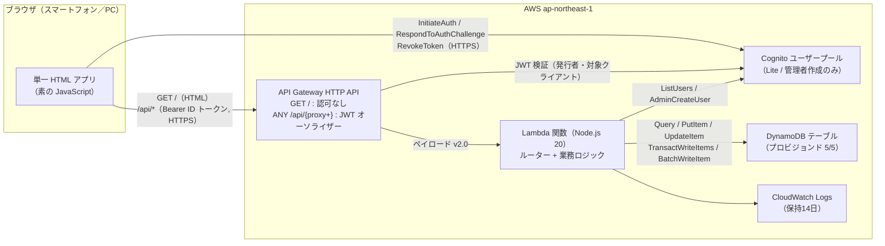
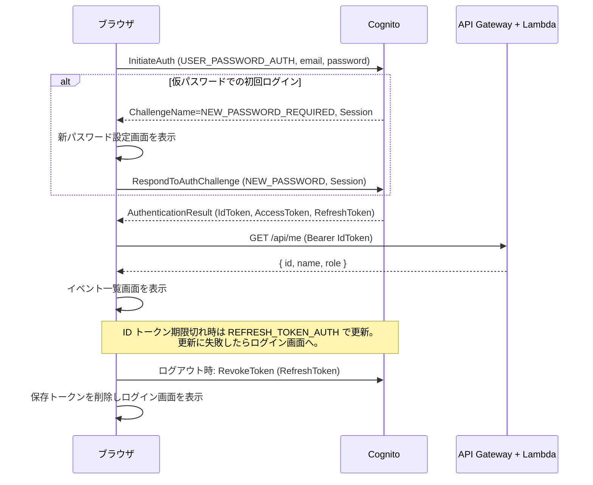

# Design Document

## Overview

ベスコングルメ部の運営サービス（v1: イベント案内と出欠回答）を、AWS のサーバーレス構成で新規ディレクトリ `cloud-service/` に構築する。

構成の要点は次のとおり。

- **配信と API を1つの HTTP API に集約する。** Amazon API Gateway の HTTP API に Lambda 関数を1つだけ接続し、`GET /` でブラウザ画面（CSS と JavaScript をインライン化した単一 HTML）を返し、`/api/*` で JSON API を返す。S3 や CloudFront は使わない。
- **認証は Amazon Cognito ユーザープールに任せる。** ブラウザから Cognito の公開 API（`InitiateAuth` など）を `fetch` で直接呼び、発行された ID トークンを API 呼び出しの `Authorization` ヘッダーに付ける。API Gateway の JWT オーソライザーが `/api/*` の未認証リクエストを 401 で拒否する。
- **データは DynamoDB の1テーブルに保存する。** イベントと出欠回答を同じパーティションキー（イベント単位）に置き、詳細画面を1回の Query で組み立てる。
- **外部 npm パッケージは使わない。** サーバー側は Lambda Node.js 20 ランタイムに同梱の AWS SDK for JavaScript v3 のみを使い、ブラウザ側は素の JavaScript で書く。テストは `node:test` と自作の小さなプロパティテスト補助関数で行う。
- **業務ロジックは AWS から切り離した純粋関数にする。** 入力検証、日付処理、一覧の抽出と並べ替え、回答状況の集計、役割判定、画面描画を純粋関数として実装し、DynamoDB と Cognito への入出力は差し替え可能なアダプタに閉じ込める。テストはメモリ上のフェイクで実行でき、ローカルに AWS SDK は不要になる。

## 申し送り事項の決定

### 1. API Gateway の種類と12か月経過後の費用

**決定: HTTP API を使う。**

| 観点 | HTTP API | REST API |
|---|---|---|
| リクエスト単価（us-east-1 公表値） | 100万件あたり 1.00 USD | 100万件あたり 3.50 USD |
| Cognito 連携 | JWT オーソライザーを標準搭載（Lambda 不要） | Cognito オーソライザーあり |
| 月10,000件の費用（12か月経過後） | 約 0.01〜0.02 USD | 約 0.035〜0.05 USD |
| v1 で必要な機能 | ルーティング、JWT 認可、スロットリングで足りる | API キー、キャッシュ、WAF などは v1 で不要 |

- 単価は [Amazon API Gateway の料金ページ](https://aws.amazon.com/api-gateway/pricing/) の us-east-1 の値。東京リージョン（ap-northeast-1）の単価はこれより少し高い。デプロイ前に同ページで東京リージョンを選んで確認する。仮に 100万件あたり 1.50 USD としても、月10,000件で 0.015 USD（約2〜3円）にとどまる。
- 料金ページによると、API Gateway の無料利用枠（HTTP API 月100万件）はサインアップから12か月間に限られる。
- **2025年7月15日以降に作成した AWS アカウントは扱いが異なる。** 新規アカウントは12か月の無料利用枠ではなく、最大 200 USD のクレジットと6か月の無料プランの対象になる（[AWS Blog の発表](https://aws.amazon.com/blogs/aws/aws-free-tier-update-new-customers-can-get-started-and-explore-aws-with-up-to-200-in-credits/)）。この場合も API Gateway の費用はクレジットで相殺され、その後は上記と同じ月 0.02 USD 程度になる。Lambda、DynamoDB、Cognito の「常時無料」枠はアカウントの作成時期に関係なく適用される。
- 要件 10.3 との関係: 13か月目以降（または新規アカウントのクレジット消化後）は API Gateway だけが無料枠の外になる。申し送りで許容された「月額 1 USD 未満」の範囲に収まる。

> 料金とプラン内容は上記リンク先の情報を要約したもの（Content was rephrased for compliance with licensing restrictions）。

**月額費用の見積もり（メンバー10名、月10,000リクエスト、東京リージョン）**

| サービス | 想定使用量 | 無料枠 | 12か月経過後の月額 |
|---|---|---|---|
| API Gateway HTTP API | 10,000件 | 12か月間 月100万件 | 約 0.02 USD |
| Lambda（256MB） | 10,000回 × 約0.5秒 ≒ 1,250 GB-秒 | 常時無料: 100万回 + 40万 GB-秒 | 0 USD |
| DynamoDB（プロビジョンド 5 RCU / 5 WCU） | 数百 KB | 常時無料: 25 RCU + 25 WCU + 25 GB | 0 USD |
| Cognito（Lite プラン） | 10 MAU | 常時無料: 10,000 MAU | 0 USD |
| CloudWatch Logs（保持14日） | 数 MB | 常時無料: 5 GB | 0 USD |
| データ転送（インターネット向け） | 数十 MB | 常時無料: 月100 GB | 0 USD |
| S3（SAM のデプロイ成果物） | 数百 KB | 12か月間 5 GB | 0.0001 USD 未満 |

想定利用量の内訳: 9名 × 月30回の画面表示 × 1回あたり約4リクエスト ≒ 月1,100件。要件 10.3 の上限 10,000件に対して余裕がある。

**DynamoDB はオンデマンドではなくプロビジョンド容量にする。** 常時無料枠はプロビジョンド容量（25 RCU / 25 WCU）が対象で、オンデマンドのリクエスト料金は無料枠に含まれないため。

**想定外のアクセスへの備え。** HTTP API のステージにスロットリング（毎秒5件、バースト20件）を設定し、AWS Budgets（2件まで無料）で月 1 USD の予算アラートをメール通知に設定する（README に手順を書く）。スロットリングは上限を設けるだけで、悪意ある大量アクセスの費用をゼロにはしない。この残存リスクは予算アラートで検知する。

### 2. ブラウザ画面（静的ファイル）の配信方法

**決定: 同じ HTTP API の `GET /` を Lambda で処理し、単一 HTML を返す。**

| 案 | HTTPS（要件 2.5） | 要件 10.1 の4サービス内 | 費用 | 判断 |
|---|---|---|---|---|
| A. HTTP API + Lambda で HTML を返す | ○ | ○ | API リクエストとして課金（上表に含む） | **採用** |
| B. S3 静的ウェブサイトホスティング | ×（HTTP のみ） | × | S3 は12か月無料 | 不採用 |
| C. S3 + CloudFront | ○ | ×（2サービス追加） | CloudFront 常時無料枠内 | 不採用（構成が増える） |
| D. Lambda 関数 URL | ○ | ○（ただし API Gateway を迂回） | 無料 | 不採用（入口が2つになる） |

- HTML、CSS、ブラウザ用 JavaScript をコールドスタート時に1つの HTML に組み立て、メモリに保持する。1回の画面表示でかかる静的ファイルのリクエストは1件になる。
- ファビコンの自動リクエストを防ぐため `<link rel="icon" href="data:,">` を入れる。
- HTML には部のデータを一切含めない。データは認証後に `/api/*` から取得するため、`GET /` を認証なしで公開しても要件 2.1 と 2.2 に反する情報は出ない。
- 画面と API が同一オリジンになるため CORS 設定は不要。ブラウザから Cognito への呼び出しは Cognito 側が CORS に対応している。

### 3. 部員アカウントの作成手段

**決定: 運営サービスの画面（部長のみ）から作成する。最初の部長だけはデプロイ直後にスクリプトで作成する。**

| 案 | 部長の負担 | 判断 |
|---|---|---|
| A. 運営サービスの画面 | メールアドレスと表示名を入れるだけ | **採用** |
| B. AWS コンソール | IAM ユーザーが必要。属性やグループの設定を間違えやすい | 不採用 |
| C. スクリプト（AWS CLI） | 認証情報付きの CLI 環境が必要 | 最初の部長の作成にだけ使う |

- 画面から `POST /api/members` を呼ぶと、Lambda が Cognito の `AdminCreateUser` を実行する。
- 仮パスワードは Lambda が `node:crypto` で生成し、`MessageAction: "SUPPRESS"` を指定して Cognito からのメール送信を止める。作成完了画面に仮パスワードを1回だけ表示し、部長が LINE などで本人に伝える。メール送信を使わない理由は、Cognito の既定メール送信に1日50通の上限と迷惑メール判定の不確実さがあることと、通知機能が v1 のスコープ外であること。
- 仮パスワードの有効期限は7日。期限切れ時の再発行は v1 の画面には入れず、README に AWS CLI の `admin-set-user-password --no-permanent` の手順を書く。
- 最初の部長は `cloud-service/scripts/create-bucho.sh` で作成する。スクリプトは `aws cognito-idp admin-create-user` と `admin-add-user-to-group --group-name bucho` を実行する。

### 4. 外部パッケージの利用

**決定: npm パッケージは追加しない。AWS SDK for JavaScript v3 は Lambda の Node.js 20 ランタイム同梱版を使う。**

- 使う SDK モジュール: `@aws-sdk/client-dynamodb`、`@aws-sdk/lib-dynamodb`、`@aws-sdk/client-cognito-identity-provider`。いずれも nodejs20.x ランタイムに含まれている。
- `cloud-service/package.json` には `dependencies` を書かない。デプロイ成果物はソースファイルだけになる。
- SDK を `require` するのは Lambda のエントリポイント `src/handler.js` だけにする。それ以外のモジュールは SDK に依存しないので、SDK が入っていないローカル環境でも全テストが動く。
- トレードオフ: SDK のバージョンは AWS のランタイム更新に従って変わる。v1 で使う API（PutItem、Query、TransactWriteItems、ListUsers、AdminCreateUser など）は安定しており、影響は小さいと判断する。
- ブラウザ側で Amplify や amazon-cognito-identity-js は使わない。`USER_PASSWORD_AUTH` フローは Cognito の公開 API を `fetch` で呼ぶだけで実装できる。
- プロパティテスト用ライブラリ（fast-check など）も使わない。シード付き乱数生成器と `forAll` を `test/helpers/pbt.js` に自作する（後述）。

## Architecture



### リクエスト処理の流れ

1. ブラウザが `GET /` を要求する。Lambda は組み立て済みの HTML を返す。HTML のスクリプトはローカルストレージのセッションを調べ、無効ならログイン画面を描画する。
2. ログイン後のブラウザは `/api/*` に `Authorization: Bearer <ID トークン>` を付けて要求する。
3. API Gateway の JWT オーソライザーがトークンの署名、有効期限、発行者（ユーザープール）、対象（アプリクライアント ID）を検証する。不正なら Lambda を呼ばずに 401 を返す。
4. Lambda はペイロード v2.0 の `requestContext.authorizer.jwt.claims` からメンバー ID（`sub`）、表示名（`name`）、役割（`cognito:groups`）を取り出す。claims が無い場合も Lambda 自身が 401 を返す（多層防御）。
5. ルーターがメソッドとパスで処理関数を選ぶ。処理関数は役割確認、入力検証、リポジトリ呼び出しの順に実行し、JSON を返す。

### ログインの流れ



### セッションの設計

- ID トークンとアクセストークンの有効期限は60分、リフレッシュトークンは30日。
- トークンはローカルストレージ（キー `bcg.session`）に保存する。スマートフォンでブラウザを閉じるたびに再ログインさせないため。XSS 対策として、すべての表示値を HTML エスケープし、Content-Security-Policy でインラインスクリプトをハッシュ指定のものに限定する。
- API が 401 を返すか ID トークンの `exp` を過ぎた場合、リフレッシュを1回試す。失敗したらセッションを削除し、「ログインの有効期限が切れました。再度ログインしてください」と表示してログイン画面に戻す（要件 1.5）。
- ログアウト（要件 1.4）では `RevokeToken` でリフレッシュトークンを失効させ、保存トークンを削除する。発行済みの ID トークンは API Gateway の JWT オーソライザーが失効を確認しないため、最長60分は技術的に有効なまま残る。ブラウザからは削除済みなので通常の利用者には影響しない。トークンを盗まれた場合の影響時間を60分に限定するという判断である。

## ディレクトリ構成

既存フライヤー資産（`.agents/flyer/`、`.kiro/skills/bescon-flyer/`、ワークスペース直下の `BCG企画_*.svg/png`）には一切触れない。

```
cloud-service/
├── package.json              # "test": "node --test"。dependencies なし
├── template.json             # AWS SAM テンプレート（JSON 形式。テストで JSON.parse して検査する）
├── README.md                 # デプロイ、最初の部長作成、予算アラート、仮パスワード再発行の手順
├── scripts/
│   └── create-bucho.sh       # 最初の部長アカウントを作成する
├── src/                      # Lambda にデプロイする範囲（CodeUri）
│   ├── handler.js            # Lambda エントリ。SDK クライアント生成と依存の組み立て
│   ├── app.js                # createApp(deps) → handle(event)
│   ├── router.js             # メソッドとパスから処理関数を選ぶ
│   ├── http.js               # レスポンス生成、HttpError、JSON 本文の解析
│   ├── auth.js               # claims → Identity（id, name, role）
│   ├── validation.js         # validateEventInput / validateRsvpInput / validateMemberInput
│   ├── events.js             # selectEvents / toListItem / summarize
│   ├── password.js           # generateTemporaryPassword
│   ├── page.js               # 単一 HTML の組み立てと CSP ハッシュ計算
│   ├── repo/dynamo.js        # DynamoDB リポジトリ（send 関数を注入）
│   ├── directory/cognito.js  # Cognito メンバーディレクトリ（send 関数を注入）
│   ├── shared/               # サーバーとブラウザの両方で使う（UMD 形式）
│   │   ├── dates.js          # todayJst / isUpcoming / isValidDate / isValidTime / formatDateJa
│   │   ├── labels.js         # 項目名、回答ラベル、メッセージ
│   │   ├── session.js        # isTokenExpired / resolveView / nextAuthStep / mapAuthError
│   │   └── render.js         # 画面の HTML 文字列を返す純粋関数
│   └── web/
│       ├── index.html        # HTML の骨組み（設定・スタイル・スクリプトの差し込み位置）
│       ├── style.css
│       ├── cognito-client.js # Cognito 公開 API の fetch ラッパー（fetch を注入）
│       └── app.js            # ブラウザ側の制御（状態、ハッシュルーティング、イベント処理）
└── test/
    ├── helpers/
    │   ├── pbt.js            # シード付き乱数、ジェネレーター、forAll
    │   ├── generators.js     # イベント入力、メンバー、claims などの生成器
    │   ├── memory-repo.js    # Repo のメモリ実装
    │   └── fake-directory.js # Directory のメモリ実装
    ├── fixtures/
    │   └── flyer-assets.sha256  # 実装開始前に取得した既存資産のハッシュ
    └── *.test.js
```

## Components and Interfaces

### API 仕様

すべての `/api/*` は JWT オーソライザーの保護下にある。本文とレスポンスは `application/json; charset=utf-8`。

| メソッド | パス | 役割 | 成功時 | 主なエラー |
|---|---|---|---|---|
| GET | `/` | 認可なし | 200 HTML | — |
| GET | `/api/me` | 全員 | 200 `{ id, name, email, role }` | 401 |
| GET | `/api/events?scope=upcoming\|past` | 全員 | 200 `{ events: ListItem[] }` | 400（scope 不正）, 401 |
| POST | `/api/events` | 部長 | 201 `{ event: EventDetail }` | 400, 401, 403 |
| GET | `/api/events/{id}` | 全員 | 200 `{ event: EventDetail }` | 401, 404 |
| PUT | `/api/events/{id}` | 部長 | 200 `{ event: EventDetail }` | 400, 401, 403, 404 |
| DELETE | `/api/events/{id}` | 部長 | 204 | 401, 403, 404 |
| PUT | `/api/events/{id}/rsvp` | 全員 | 200 `{ event: EventDetail }` | 400, 401, 404, 409 |
| POST | `/api/members` | 部長 | 201 `{ member: { email, name }, temporaryPassword }` | 400, 401, 403, 409 |

- `scope` を省略した場合は `upcoming` とする。
- 処理関数内の確認順序: ①認証（401）→ ②役割（403）→ ③本文の解析と入力検証（400）→ ④対象の存在（404）→ ⑤状態による制約（409）。部員が存在しないイベントの編集を要求した場合は 403 になる。
- 削除の確認（要件 5.4）は画面側で行う。`DELETE` は確認済みの操作として扱う。

### Lambda エントリと依存の組み立て（`src/handler.js`）

SDK に依存するのはこのファイルだけ。依存を組み立てた `app` はコールドスタート時に1回だけ作る。

```javascript
// src/handler.js
const { DynamoDBClient } = require('@aws-sdk/client-dynamodb');
const lib = require('@aws-sdk/lib-dynamodb');
const cip = require('@aws-sdk/client-cognito-identity-provider');
const { createApp } = require('./app');
const { createDynamoRepo } = require('./repo/dynamo');
const { createCognitoDirectory } = require('./directory/cognito');
const { buildPage } = require('./page');

const env = {
  tableName: process.env.TABLE_NAME,
  userPoolId: process.env.USER_POOL_ID,
  clientId: process.env.USER_POOL_CLIENT_ID,
  region: process.env.AWS_REGION, // Lambda が自動設定
};

const doc = lib.DynamoDBDocumentClient.from(new DynamoDBClient({}));
const idp = new cip.CognitoIdentityProviderClient({});
const ddbCommands = { Get: lib.GetCommand, Query: lib.QueryCommand, Scan: lib.ScanCommand,
  Put: lib.PutCommand, Update: lib.UpdateCommand, Delete: lib.DeleteCommand,
  TransactWrite: lib.TransactWriteCommand, BatchWrite: lib.BatchWriteCommand };
const idpCommands = { ListUsers: cip.ListUsersCommand, AdminCreateUser: cip.AdminCreateUserCommand };

const app = createApp({
  repo: createDynamoRepo({ tableName: env.tableName,
    send: (name, input) => doc.send(new ddbCommands[name](input)) }),
  directory: createCognitoDirectory({ userPoolId: env.userPoolId,
    send: (name, input) => idp.send(new idpCommands[name](input)) }),
  page: buildPage({ region: env.region, clientId: env.clientId }),
});

exports.handler = (event) => app.handle(event);
```

AWS の認証情報は Lambda の実行ロールから SDK が自動取得する。テーブル名やプール ID は CloudFormation が環境変数に設定する。ソースコードに認証情報やシークレットは含めない（要件 10.5）。アプリクライアントはクライアントシークレットなしで作成するため、ブラウザに渡す値（クライアント ID とリージョン）はいずれも秘密情報ではない。

### アプリ本体（`src/app.js`）

```javascript
/**
 * @param {Object} deps
 * @param {Repo} deps.repo
 * @param {Directory} deps.directory
 * @param {{ body: string, headers: Object }} deps.page
 * @param {() => Date} [deps.now]
 * @param {() => string} [deps.newId]          // 既定: crypto.randomUUID
 * @param {() => string} [deps.newPassword]    // 既定: generateTemporaryPassword
 * @returns {{ handle: (event: ApiGatewayV2Event) => Promise<HttpResponse> }}
 */
function createApp(deps) { /* ... */ }
```

`handle` は例外をすべて捕捉する。`HttpError` は対応するステータスに変換し、それ以外は 500 と固定メッセージ「サーバーでエラーが発生しました」を返して詳細をログにだけ出す。

### ルーター（`src/router.js`）

```javascript
/** @returns {{ name: string, params: Object } | null} */
function route(method, path) {}
// 例: route('PUT', '/api/events/abc/rsvp') → { name: 'putRsvp', params: { id: 'abc' } }
```

`GET /` 以外で一致しないパスは 404、パスは一致するがメソッドが違う場合は 405 を返す。イベント ID は `^[0-9a-f-]{36}$`（UUID）に一致しない場合も 404 とする。

### 認証情報の解釈（`src/auth.js`）

```javascript
/** @typedef {{ id: string, name: string, email: string, role: 'bucho' | 'buin' }} Identity */

/** claims が無い、または sub が無い場合は null */
function identityFromEvent(event) {}

/** cognito:groups の配列表現・文字列表現（"[bucho other]"、"bucho,other"）・欠落に対応 */
function parseGroups(value) {}

/** 戻り値は必ず 'bucho' か 'buin' のどちらか1つ（要件 3.3） */
function roleFromClaims(claims) {
  return parseGroups(claims['cognito:groups']).includes('bucho') ? 'bucho' : 'buin';
}
```

HTTP API の JWT オーソライザーは配列型のクレームを `"[bucho]"` のような文字列にして Lambda に渡すことがあるため、`parseGroups` で両方の形式を受け付ける。

役割は Cognito グループ `bucho` への所属で決める。所属していれば部長、それ以外はすべて部員となり、役割が0個や2個になる状態は表現できない。

### 入力検証（`src/validation.js`）

```javascript
const EVENT_FIELDS = [
  { key: 'title',    label: '編名',         maxLength: 30 },
  { key: 'date',     label: '開催日',       format: 'date' },
  { key: 'time',     label: '集合時刻',     format: 'time' },
  { key: 'place',    label: '集合場所',     maxLength: 100 },
  { key: 'exercise', label: '運動内容',     maxLength: 200 },
  { key: 'reward',   label: 'ご褒美の食事', maxLength: 200 },
];

/**
 * @returns {{ ok: true, value: EventFields } | { ok: false, errors: FieldError[] }}
 * FieldError = { field: string, code: 'required'|'format'|'maxLength', message: string }
 */
function validateEventInput(input) {}

/** @returns {{ ok: true, value: 'attend'|'absent' } | { ok: false }} */
function validateRsvpInput(input) {}

/** @returns {{ ok: true, value: { email, name } } | { ok: false, errors: FieldError[] }} */
function validateMemberInput(input) {}
```

検証規則:

- 各値は文字列なら前後の空白（全角空白を含む `\s`）を除いてから判定する。欠落、`null`、文字列以外、除去後に空文字の値は `required` とする。
- 文字数はコードポイント数（`[...s].length`）で数える。絵文字1文字は1文字と数える。
- エラーは1項目につき最大1件。`required` を最優先し、次に `format` または `maxLength` を判定する。全項目のエラーを `EVENT_FIELDS` の順に返す。
- 6項目以外のキーは無視する。保存するのは除去後の値。
- 開催日: `^\d{4}-\d{2}-\d{2}$` に一致し、月が1〜12、日がその月の日数以内（閏年はグレゴリオ暦の規則）であること。
- 集合時刻: `^([01]\d|2[0-3]):[0-5]\d$`。
- 出欠回答: `input.status` が `'attend'`（参加）か `'absent'`（不参加）のいずれか。
- メンバー: メールアドレスは除去後に小文字化し、254文字以内で `^[^\s@]+@[^\s@]+\.[^\s@]+$` に一致すること。表示名は1〜30文字。

エラーメッセージ（`src/shared/labels.js`）:

| code | メッセージ例 |
|---|---|
| required | 「編名」を入力してください |
| format（開催日） | 開催日は YYYY-MM-DD 形式の実在する日付で入力してください |
| format（集合時刻） | 集合時刻は 00:00〜23:59 の HH:MM 形式で入力してください |
| maxLength | 「集合場所」は100文字以内で入力してください（現在112文字） |

### 日付処理（`src/shared/dates.js`）

日本には夏時間がないため、JST は UTC に固定で9時間を足して求める。

```javascript
/** now の日本時間の暦日 'YYYY-MM-DD' */
function todayJst(now) {
  return new Date(now.getTime() + 9 * 3600 * 1000).toISOString().slice(0, 10);
}
/** 開催日が日本時間の当日以降なら true（開催予定イベント） */
function isUpcoming(date, now) { return date >= todayJst(now); }
function isValidDate(s) {}
function isValidTime(s) {}
/** '2026-11-14' → '2026年11月14日（土）'（月日の先頭ゼロなし、全角括弧） */
function formatDateJa(date) {}
```

`YYYY-MM-DD` は辞書順と時系列順が一致するので、日付比較は文字列比較で行う。曜日は `Date.UTC` で求める。

### 一覧と集計（`src/events.js`）

```javascript
/**
 * @param {Event[]} events
 * @param {'upcoming'|'past'} scope
 * @param {Date} now
 * upcoming: date >= todayJst(now) を (date, time, id) の昇順
 * past:     date <  todayJst(now) を (date, time) の降順、同値は id の昇順
 */
function selectEvents(events, scope, now) {}

/** @returns {ListItem}  myStatus は当該メンバーの回答、無ければ 'none' */
function toListItem(event, rsvpOfMember) {}

/**
 * @param {Member[]} members  現在のメンバー一覧（Cognito）
 * @param {Rsvp[]} rsvps      当該イベントの出欠回答
 * @returns {Summary}
 * 各メンバーを attend / absent / none のちょうど1つに分類する。
 * メンバー一覧にいない memberId の回答（削除済みアカウントなど）は数えない。
 * 各一覧は表示名の昇順（localeCompare('ja')）。
 */
function summarize(members, rsvps) {}
```

### リポジトリ（`src/repo/dynamo.js`）

```javascript
/**
 * @typedef {Object} Repo
 * @property {(memberId: string) => Promise<{ events: Event[], myRsvps: Rsvp[] }>} listEventsFor
 * @property {(id: string) => Promise<{ event: Event|null, rsvps: Rsvp[] }>} getEventWithRsvps
 * @property {(event: Event) => Promise<void>} createEvent
 * @property {(id: string, fields: EventFields, updatedAt: string) => Promise<Event|null>} updateEvent
 * @property {(id: string) => Promise<boolean>} deleteEvent
 * @property {(rsvp: Rsvp, expectedDate: string) => Promise<'ok'|'not_found'|'changed'>} putRsvp
 */
function createDynamoRepo({ tableName, send }) {}
```

| メソッド | DynamoDB 操作 |
|---|---|
| `listEventsFor` | `Scan`（`FilterExpression: sk = :meta OR sk = :mine`）。`LastEvaluatedKey` がある間は繰り返す |
| `getEventWithRsvps` | `Query`（`pk = EVENT#id`）。`sk = META` がイベント、`RSVP#*` が回答 |
| `createEvent` | `Put`（`ConditionExpression: attribute_not_exists(pk)`） |
| `updateEvent` | `Update`（`SET` で6項目と updatedAt、`ConditionExpression: attribute_exists(pk)`、`ReturnValues: ALL_NEW`）。条件失敗なら null。回答の項目は触らない（要件 5.3） |
| `deleteEvent` | 下記の手順 |
| `putRsvp` | `TransactWrite`: ① `ConditionCheck`（META が存在し `#date = :expectedDate`）② `Put`（`pk=EVENT#id, sk=RSVP#memberId`）。条件失敗時は META を読み直し、無ければ `not_found`、あれば `changed` |

削除の手順（要件 5.5）:

1. `Delete` で META を削除する（`ConditionExpression: attribute_exists(pk)`）。この時点でイベントは見えなくなり、`putRsvp` の条件確認が失敗するので新しい回答は追加されない。
2. `Query` で同じ `pk` の残り項目（回答）を取得し、`BatchWrite` で25件ずつ削除する。`UnprocessedItems` は最大3回まで再試行する。
3. META が既に無い場合でも手順2を実行してから `false`（404）を返す。手順2の途中で失敗して回答が残った場合も、同じ削除操作を再実行すれば消える。残った回答は META が無いため一覧にも集計にも現れない。

一覧取得に Scan を使う理由: 1件の項目は約300バイトで、年20イベント × 回答10件としても年に約66 KB しか増えない。結果整合性読み込みの Scan は 8 KB あたり 1 RCU なので、数年分でも1回数 RCU に収まる。GSI を追加すると構成と書き込み容量が増えるため、v1 では使わない。データが 1 MB を超えるほど増えた場合は「type + date」の GSI を追加する。

### メンバーディレクトリ（`src/directory/cognito.js`）

```javascript
/**
 * @typedef {{ id: string, name: string, email: string }} Member
 * @typedef {Object} Directory
 * @property {() => Promise<Member[]>} listMembers
 *   ListUsers を PaginationToken がある間繰り返し、Enabled=true のユーザーだけ返す。
 *   仮パスワードのままのユーザー（FORCE_CHANGE_PASSWORD）も含める（未回答として表示するため）。
 *   name 属性が無いユーザーは email を表示名とする。
 * @property {(m: { email: string, name: string, temporaryPassword: string }) => Promise<Member>} createMember
 *   AdminCreateUser（Username=email, UserAttributes=[email, email_verified=true, name],
 *   TemporaryPassword, MessageAction='SUPPRESS'）。
 *   UsernameExistsException は DirectoryError('EMAIL_EXISTS') に変換する。
 */
function createCognitoDirectory({ userPoolId, send }) {}
```

部員として作成するため、グループには追加しない。

### 仮パスワード（`src/password.js`）

```javascript
/** 12文字。英小文字・英大文字・数字をそれぞれ1文字以上含む。紛らわしい 0 O o 1 l I は使わない。 */
function generateTemporaryPassword(randomInt = crypto.randomInt) {}
```

Cognito のパスワードポリシー（8文字以上、英小文字と数字を必須）を常に満たす。

### ブラウザ画面

#### 画面一覧とハッシュルーティング

| ハッシュ | 画面 | 部員 | 部長 |
|---|---|---|---|
| `#/login` | ログイン | ○ | ○ |
| `#/new-password` | 新パスワード設定（初回） | ○ | ○ |
| `#/events` | 開催予定イベント一覧（既定） | ○ | ○（「イベントを登録」ボタンあり） |
| `#/events/past` | 終了イベント一覧 | ○ | ○ |
| `#/events/{id}` | イベント詳細 + 回答状況 + 出欠ボタン | ○ | ○（「編集」「削除」ボタンあり） |
| `#/events/new` | イベント登録フォーム | ×（一覧へ戻す） | ○ |
| `#/events/{id}/edit` | イベント編集フォーム | ×（詳細へ戻す） | ○ |
| `#/members/new` | 部員アカウント作成 | ×（一覧へ戻す） | ○ |

全画面のヘッダーにログアウトボタンを置く。部長には「部員を追加」リンクも表示する。

#### 共有モジュール（`src/shared/session.js`）

```javascript
/** ID トークンの exp（秒）を base64url デコードして読み、now + 60秒 >= exp なら期限切れ */
function isTokenExpired(idToken, now) {}

/**
 * @param {string} hash   location.hash
 * @param {{ idToken: string, role?: string } | null} session
 * @param {Date} now
 * @returns {{ view: string, params: Object }}
 * セッションが無い、または期限切れなら、hash に関係なく { view: 'login' }（要件 1.5, 2.2）。
 * 部員が管理用ハッシュに来た場合は一覧または詳細に読み替える。
 */
function resolveView(hash, session, now) {}

/**
 * Cognito の InitiateAuth / RespondToAuthChallenge の応答を次の状態に変換する。
 * @returns {{ type: 'signed-in', tokens } | { type: 'new-password', session } | { type: 'error', message }}
 */
function nextAuthStep(response) {}

/** NotAuthorizedException と UserNotFoundException は同じ文言（要件 1.2） */
function mapAuthError(code) {}
```

リフレッシュ時は ID トークンを更新した直後に `resolveView` で再判定する。リフレッシュに失敗した場合は `session` を null として判定するので、期限切れはログイン画面になる。

#### 描画関数（`src/shared/render.js`）

```javascript
/** すべての描画関数は (data, role) → HTML 文字列。すべての値を escapeHtml で通す。 */
function renderEventList({ scope, events }, role) {}  // 0件: 「開催予定のイベントはありません」
function renderEventDetail({ event }, role) {}        // 6項目、回答状況、出欠ボタン or 「回答の受付は終了しました」
function renderEventForm({ mode, values, errors }) {} // 部長のみ到達
function renderMemberForm({ values, errors, created }) {}
function renderLogin({ message }) {}
function renderNewPassword({ message }) {}
function escapeHtml(s) {} // & < > " ' をエスケープ
```

管理用の操作部品には必ず `data-action` 属性（`create-event`、`edit-event`、`delete-event`、`create-member`）を付ける。描画関数は `role !== 'bucho'` のときこれらを出力しない（要件 6.3）。サーバー側の 403（要件 6.1、6.2）があるので、画面で部品を隠すのは見た目のためであり、権限の担保はサーバー側で行う。

一覧の各行には編名、`formatDateJa(date)`、集合時刻、自分の回答ラベル（参加／不参加／未回答）を表示する（要件 7.3）。

削除ボタンは `window.confirm('「{編名}」を削除します。出欠回答もすべて削除されます。よろしいですか？')` を表示し、OK のときだけ `DELETE` を送る（要件 5.4）。

#### UMD 形式

`src/shared/*.js` と `src/web/cognito-client.js` は Node.js からは `require` で、ブラウザからはグローバル `BCG` 経由で使えるようにする。

```javascript
(function (root, factory) {
  const api = factory(typeof require === 'function' ? require : (n) => root.BCG);
  if (typeof module === 'object' && module.exports) module.exports = api;
  else root.BCG = Object.assign(root.BCG || {}, api);
})(typeof self !== 'undefined' ? self : this, function (req) {
  const { formatDateJa } = req('./dates');
  // ...
  return { renderEventList, renderEventDetail /* ... */ };
});
```

#### HTML の組み立てと応答ヘッダー（`src/page.js`）

`buildPage({ region, clientId })` は `web/index.html` に次を差し込む。

1. `<script type="application/json" id="bcg-config">` に `{ region, clientId, cognitoEndpoint: "https://cognito-idp.{region}.amazonaws.com/" }`（JSON は `<` を `\u003c` にエスケープ）
2. `<style>` に `style.css`
3. `<script>` を `shared/dates.js`、`shared/labels.js`、`shared/session.js`、`shared/render.js`、`web/cognito-client.js`、`web/app.js` の順に並べる

各インラインスクリプトとスタイルの SHA-256 を `node:crypto` で計算し、次のヘッダーを付ける。

| ヘッダー | 値 |
|---|---|
| Content-Security-Policy | `default-src 'none'; script-src 'sha256-…' …; style-src 'sha256-…'; connect-src 'self' https://cognito-idp.{region}.amazonaws.com; img-src data:; base-uri 'none'; form-action 'none'; frame-ancestors 'none'` |
| Strict-Transport-Security | `max-age=31536000` |
| X-Content-Type-Options | `nosniff` |
| Referrer-Policy | `no-referrer` |
| Cache-Control | HTML: `no-cache`、API: `no-store` |

## Data Models

### DynamoDB テーブル `BesconTable`

- キー: `pk`（String, パーティション）、`sk`（String, ソート）
- 課金モード: `PROVISIONED`（ReadCapacityUnits 5、WriteCapacityUnits 5）。GSI なし。
- ポイントインタイムリカバリは使わない（有料のため）。

**イベント項目**

| 属性 | 型 | 例 |
|---|---|---|
| pk | S | `EVENT#3f2b…`（UUID） |
| sk | S | `META` |
| id | S | `3f2b…` |
| title | S | `山寺編` |
| date | S | `2026-11-14` |
| time | S | `09:30` |
| place | S | `山寺駅前` |
| exercise | S | `立石寺の石段1,015段を登る` |
| reward | S | `山寺そば` |
| createdBy | S | 作成した部長の sub |
| createdAt / updatedAt | S | ISO 8601（UTC） |

**出欠回答項目**

| 属性 | 型 | 例 |
|---|---|---|
| pk | S | `EVENT#3f2b…` |
| sk | S | `RSVP#<メンバーの sub>` |
| eventId | S | `3f2b…` |
| memberId | S | Cognito の `sub` |
| status | S | `attend` または `absent` |
| updatedAt | S | ISO 8601（UTC） |

キーが（イベント, メンバー）の組なので、1名1イベントの回答は構造上1件しか存在できない（要件 8.3）。回答の変更は同じキーへの上書きになる（要件 8.2）。未回答は「項目が存在しない」ことで表す（要件 4.6）。

### Cognito ユーザープール

| 設定 | 値 | 対応要件 |
|---|---|---|
| UserPoolTier | `LITE` | 10.3 |
| UsernameAttributes | `["email"]`、UsernameConfiguration.CaseSensitive = false | 1.1, 3.2 |
| AdminCreateUserConfig.AllowAdminCreateUserOnly | `true` | 2.3, 2.4 |
| Policies.PasswordPolicy | 8文字以上、英小文字と数字を必須、TemporaryPasswordValidityDays = 7（仮パスワードの有効期限） | 1.3, 3.1 |
| Schema | `email`（必須）、`name`（必須、表示名） | 3.1, 9.2 |
| グループ | `bucho` | 3.3 |
| アプリクライアント | シークレットなし、ExplicitAuthFlows = `ALLOW_USER_PASSWORD_AUTH`, `ALLOW_REFRESH_TOKEN_AUTH`、PreventUserExistenceErrors = `ENABLED`、EnableTokenRevocation = `true`、ID/アクセス 60分、リフレッシュ 30日 | 1.2, 1.4, 1.5 |

Cognito の組み込みのアカウントロック（連続失敗時の一時ロック）でパスワード総当たりを抑える。

### API のデータ形式

```javascript
/** @typedef {{ title, date, time, place, exercise, reward }} EventFields  すべて string */
/** @typedef {EventFields & { id, createdAt, updatedAt, createdBy }} Event */
/** @typedef {{ eventId, memberId, status: 'attend'|'absent', updatedAt }} Rsvp */

/** @typedef {{ id, title, date, dateLabel, time, myStatus: 'attend'|'absent'|'none' }} ListItem */

/**
 * @typedef {Object} Summary
 * @property {{ attend: number, absent: number, none: number }} counts
 * @property {{ attend: string[], absent: string[], none: string[] }} names  表示名
 */

/**
 * @typedef {EventFields & { id, dateLabel, acceptingResponses: boolean,
 *   myStatus: 'attend'|'absent'|'none', summary: Summary }} EventDetail
 */
```

回答状況には表示名だけを含め、メールアドレスは含めない。

### SAM テンプレート（`template.json`）の主なリソース

| 論理 ID | 種別 | 主な設定 |
|---|---|---|
| UserPool | `AWS::Cognito::UserPool` | 上表 |
| UserPoolClient | `AWS::Cognito::UserPoolClient` | 上表 |
| BuchoGroup | `AWS::Cognito::UserPoolGroup` | GroupName `bucho` |
| Table | `AWS::DynamoDB::Table` | 上記 |
| HttpApi | `AWS::Serverless::HttpApi` | JWT オーソライザー（Issuer `https://cognito-idp.{region}.amazonaws.com/{UserPoolId}`、Audience `[ClientId]`、IdentitySource `$request.header.Authorization`）、DefaultRouteSettings のスロットリング 5/20 |
| AppFunction | `AWS::Serverless::Function` | Runtime `nodejs20.x`、Handler `handler.handler`、CodeUri `src/`、MemorySize 256、Timeout 10、環境変数 TABLE_NAME / USER_POOL_ID / USER_POOL_CLIENT_ID、イベント `GET /`（認可なし）と `ANY /api/{proxy+}`（JWT） |
| AppFunctionLogGroup | `AWS::Logs::LogGroup` | RetentionInDays 14 |

Lambda 実行ロールの権限は最小限にする: テーブルに対する `GetItem`、`Query`、`Scan`、`PutItem`、`UpdateItem`、`DeleteItem`、`BatchWriteItem`、`ConditionCheckItem`（TransactWriteItems 用）と、ユーザープールに対する `cognito-idp:ListUsers`、`cognito-idp:AdminCreateUser`、およびロググループへの書き込み。

デプロイは `sam deploy --template-file template.json --guided` で行う。SAM CLI は開発者 PC のツールであり、運営サービスの依存パッケージではない。

## Error Handling

API のエラーレスポンスは次の形式に統一する。

```json
{ "error": { "code": "VALIDATION_FAILED", "message": "入力内容に誤りがあります",
  "fields": [{ "field": "title", "code": "required", "message": "「編名」を入力してください" }] } }
```

| 状況 | ステータス | code | 画面の表示 |
|---|---|---|---|
| トークンなし・不正（API Gateway） | 401 | （API Gateway 既定の `{"message":"Unauthorized"}`） | リフレッシュを試し、失敗したらログイン画面 |
| claims なし（Lambda の多層防御） | 401 | `UNAUTHENTICATED` | 同上 |
| 部員による管理操作 | 403 | `FORBIDDEN` | 「この操作は部長のみ行えます」 |
| 本文が JSON でない、または 16 KB 超 | 400 | `BAD_REQUEST` | 「送信内容を読み取れませんでした」 |
| イベント入力の検証エラー | 400 | `VALIDATION_FAILED` | 各項目の下に `fields[].message` |
| 出欠回答の値が不正 | 400 | `INVALID_RSVP` | 「回答は参加または不参加を選んでください」 |
| `scope` が不正 | 400 | `BAD_REQUEST` | — |
| メンバー入力の検証エラー | 400 | `VALIDATION_FAILED` | 各項目の下に表示 |
| イベントが存在しない | 404 | `EVENT_NOT_FOUND` | 「イベントが見つかりません」と一覧へのリンク |
| 未定義のパス | 404 | `NOT_FOUND` | — |
| メソッド不一致 | 405 | `METHOD_NOT_ALLOWED` | — |
| 終了イベントへの回答 | 409 | `RSVP_CLOSED` | 「このイベントの回答受付は終了しました」 |
| 回答中にイベントの開催日が変更された | 409 | `EVENT_CHANGED` | 「イベント内容が更新されました。画面を再読み込みしてください」 |
| メールアドレスが登録済み | 409 | `EMAIL_EXISTS` | 「このメールアドレスは登録済みです」 |
| ログイン失敗（Cognito） | — | `NotAuthorizedException` / `UserNotFoundException` | 「メールアドレスまたはパスワードが正しくありません」 |
| 試行回数超過（Cognito） | — | `TooManyRequestsException` など | 「しばらく時間をおいてから再度お試しください」 |
| 新パスワードがポリシー違反（Cognito） | — | `InvalidPasswordException` | 「パスワードは8文字以上で、英小文字と数字を含めてください」 |
| 想定外の例外 | 500 | `INTERNAL` | 「サーバーでエラーが発生しました。時間をおいて再度お試しください」 |

- 500 の詳細（スタック、AWS のエラーコード）は CloudWatch Logs にだけ出す。ログに ID トークン、仮パスワード、リクエスト本文は出さない。
- 検証エラーや 409 のときはデータを一切変更しない。
- API Gateway のスロットリング（429）は「アクセスが集中しています。しばらくしてから再度お試しください」と表示する。

## Correctness Properties

*A property is a characteristic or behavior that should hold true across all valid executions of a system-essentially, a formal statement about what the system should do. Properties serve as the bridge between human-readable specifications and machine-verifiable correctness guarantees.*

以下の性質は、メモリ上のリポジトリ（`test/helpers/memory-repo.js`）とフェイクディレクトリを注入した `createApp`、または純粋関数に対して検証する。「ストア」はメモリリポジトリの全項目（イベントと出欠回答）を指す。

### Property 1: 未認証の API リクエストはデータを返さない

*For any* ストアの内容、*for any* `/api/` 配下のメソッドとパスと本文の組み合わせについて、claims を持たないリクエストを `handle` に渡すと、ステータスは 401 になり、レスポンス本文は `{ error: { code: 'UNAUTHENTICATED', message } }` だけを含み、ストアは変化しない。

**Validates: Requirements 2.1**

### Property 2: セッションが無効なら画面は常にログイン

*For any* ハッシュ文字列と現在時刻について、セッションが無い場合、または ID トークンの `exp` が現在時刻 + 60秒以下の場合、`resolveView` は `login` を返す。`exp` が現在時刻 + 60秒より後で、ハッシュが一般画面を指す場合は `login` を返さない。

**Validates: Requirements 1.5, 2.2**

### Property 3: 役割は常にちょうど1つ

*For any* グループ名の集合と、その表現形式（配列、`"[a b]"` 形式の文字列、カンマ区切り文字列、欠落）について、`roleFromClaims` は `'bucho'` か `'buin'` のどちらか1つを返し、`'bucho'` を返すのは集合に `bucho` が含まれるときに限る。

**Validates: Requirements 3.3**

### Property 4: 仮パスワードはパスワードポリシーを満たす

*For any* 乱数系列について、`generateTemporaryPassword` の結果は12文字で、英小文字・英大文字・数字をそれぞれ1文字以上含み、許可された文字（紛らわしい `0 O o 1 l I` を除く英数字）だけで構成される。

**Validates: Requirements 3.1**

### Property 5: イベント登録のラウンドトリップと初期状態

*For any* 有効なイベント入力（前後の空白、日本語、絵文字、HTML 特殊文字を含む）と、*for any* メンバー集合について、部長が `POST /api/events` すると 201 が返り、続く `GET /api/events/{id}` の6項目は前後の空白を除いた入力と一致し、回答状況は全メンバーが未回答（`counts.none` = メンバー数、`attend` と `absent` は0）になる。

**Validates: Requirements 4.1, 4.6**

### Property 6: 空欄の項目を正確に指摘する

*For any* 有効なイベント入力と、6項目の任意の空でない部分集合について、その部分集合の各項目を欠落、`null`、空文字、空白のみ（全角空白を含む）のいずれかに置き換えると、`validateEventInput` は失敗し、`code: 'required'` のエラー項目の集合は置き換えた部分集合と一致し、各メッセージはその項目名を含む。

**Validates: Requirements 4.2**

### Property 7: 開催日と集合時刻の形式判定がオラクルと一致する

*For any* 文字列（数字・ハイフン・コロンの任意の並び、範囲外の年月日時分、閏年の2月29日を含む）について、`isValidDate` の結果は「正規表現 `^\d{4}-\d{2}-\d{2}$` に一致し、`Date.UTC` で組み立てた日付の年月日が元の値と一致する」という独立した判定と等しく、`isValidTime` の結果は「`HH:MM` 形式で 0 ≤ HH ≤ 23 かつ 0 ≤ MM ≤ 59」という判定と等しい。`validateEventInput` は判定が偽の値に対して該当項目の `format` エラーを返す。

**Validates: Requirements 4.3, 4.4**

### Property 8: 文字数上限の境界

*For any* 上限付きの項目（編名30、集合場所100、運動内容200、ご褒美の食事200）と、*for any* コードポイント数 n の空白以外の文字列について、n が上限以下なら `maxLength` エラーは出ず、n が上限を超えると `maxLength` エラーが出て、メッセージに項目名と上限の数値が含まれる。

**Validates: Requirements 4.5**

### Property 9: 不正なイベント入力は登録でも編集でも保存されない

*For any* ストアの内容と、`validateEventInput` が失敗する任意の入力について、部長の `POST /api/events` と、既存イベントへの `PUT /api/events/{id}` はどちらも 400 を返し、レスポンスの `fields` は `validateEventInput` のエラーと一致し、ストアは変化しない。

**Validates: Requirements 4.2, 4.3, 4.4, 4.5, 5.2**

### Property 10: 編集は6項目を置き換え、出欠回答を保持する

*For any* 出欠回答を持つ既存イベントと、*for any* 有効な新しい入力について、部長が `PUT /api/events/{id}` すると、続く `GET` の6項目は新しい入力と一致し、ストア内のそのイベントの出欠回答の集合は編集前と等しい。

**Validates: Requirements 5.1, 5.3**

### Property 11: 削除は対象イベントとその出欠回答だけを取り除く

*For any* 複数のイベントと出欠回答を持つストアと、その中の任意のイベント X について、部長が `DELETE /api/events/X` すると 204 が返り、ストアに X のイベント項目も X の出欠回答も残らず、X 以外のイベントと出欠回答は削除前と等しい。

**Validates: Requirements 5.5**

### Property 12: 部員の管理操作は 403 で何も変えない

*For any* ストアの内容、*for any* 部員の claims、*for any* 管理操作（`POST /api/events`、`PUT /api/events/{id}`、`DELETE /api/events/{id}`、`POST /api/members`。ID の存在の有無と本文の正否を問わない）について、`handle` は 403 を返し、ストアとディレクトリは変化しない。

**Validates: Requirements 6.1, 6.2**

### Property 13: 部員向けの画面には管理用の操作部品が無い

*For any* 一覧データ、詳細データ（回答受付中・終了の両方）について、`role = 'buin'` で描画した HTML は `data-action="create-event"`、`edit-event`、`delete-event`、`create-member` のいずれも含まない。同じデータを `role = 'bucho'` で描画すると、一覧には `create-event` が、詳細には `edit-event` と `delete-event` が含まれる。

**Validates: Requirements 6.3**

### Property 14: 一覧の分割と並び順

*For any* イベントの集合と現在時刻（JST の日付境界である UTC 15:00 前後を含む）について、`selectEvents(…, 'upcoming', now)` は開催日 ≥ `todayJst(now)` のイベントをすべて、開催日の昇順で返し、`'past'` は開催日 < `todayJst(now)` のイベントをすべて、開催日の降順で返す。2つの結果は互いに素で、和集合は元の集合に等しい。`todayJst(now)` は `now` に9時間を足した UTC 日付と等しい。

**Validates: Requirements 7.1, 7.2**

### Property 15: 一覧の各行は自分の回答を示す

*For any* イベントの集合、出欠回答の集合、閲覧中のメンバーについて、`GET /api/events` の各項目の `myStatus` は、そのメンバーのそのイベントへの回答があればその値、無ければ `'none'` になり、他のメンバーの回答の影響を受けない。

**Validates: Requirements 7.3**

### Property 16: 画面には必要な項目がエスケープされて含まれる

*For any* イベント（HTML 特殊文字 `& < > " '` を含む任意の文字列の項目）と回答状況について、`renderEventList` の各行は `escapeHtml(title)`、`formatDateJa(date)`、`escapeHtml(time)`、自分の回答ラベルを含み、`renderEventDetail` は6項目すべての `escapeHtml` 済みの値、参加・不参加・未回答の人数、各メンバーのエスケープ済み表示名を含む。どちらの出力にも項目値由来のエスケープされていない `<` は現れない。

**Validates: Requirements 7.3, 7.4, 9.1, 9.2**

### Property 17: 開催日の表示形式と曜日

*For any* 有効な日付 `YYYY-MM-DD` について、`formatDateJa` の結果は `^\d{4}年([1-9]|1[0-2])月([1-9]|[12]\d|3[01])日（[日月火水木金土]）$` に一致し、曜日は `Date.UTC` で求めた曜日と一致し、結果から取り出した年月日はゼロ埋めすると元の文字列に戻る。

**Validates: Requirements 7.5**

### Property 18: 存在しないイベントは 404

*For any* ストアの内容と、ストアに存在しない任意のイベント ID について、認証済みメンバーの `GET /api/events/{id}`、`PUT /api/events/{id}/rsvp`（有効な本文）と、部長の `PUT /api/events/{id}`（有効な本文）、`DELETE /api/events/{id}` はすべて 404 と `EVENT_NOT_FOUND` を返し、ストアは変化しない。

**Validates: Requirements 7.6**

### Property 19: 出欠回答は1人1件で、最後の回答が反映される

*For any* 開催予定イベントと、部長と部員が混在するメンバー集合と、*for any* 回答操作の列（メンバーと `attend`/`absent` の組の並び）について、操作をすべて `PUT /api/events/{id}/rsvp` で適用すると、ストア内のそのイベントの出欠回答はメンバーごとに高々1件で、その値は単純なモデル（Map に順に上書き）の最終値と一致し、`GET /api/events/{id}` の回答状況もそのモデルと一致する。

**Validates: Requirements 8.1, 8.2, 8.3, 8.4, 9.3**

### Property 20: 終了イベントへの回答は保存されない

*For any* 現在時刻と、開催日が `todayJst(now)` より前のイベントと、*for any* 有効な回答について、`PUT /api/events/{id}/rsvp` は 409 と `RSVP_CLOSED` を返し、ストアは変化しない。

**Validates: Requirements 8.5**

### Property 21: 不正な回答値は 400

*For any* `'attend'` と `'absent'` 以外の JSON 値（他の文字列、大文字違い、数値、真偽値、null、配列、オブジェクト、欠落）を `status` に持つ本文について、`PUT /api/events/{id}/rsvp` は 400 と `INVALID_RSVP` を返し、ストアは変化しない。

**Validates: Requirements 8.6**

### Property 22: 回答の登録者はセッションのメンバー

*For any* 認証済みメンバーと、`memberId`、`sub`、`userId` などに任意の値を入れた本文について、`PUT /api/events/{id}/rsvp` で保存される出欠回答の `memberId` は claims の `sub` と等しく、他のメンバーの回答は変化しない。

**Validates: Requirements 8.7**

### Property 23: 回答状況は全メンバーをちょうど1回ずつ分類する

*For any* メンバー集合と、*for any* 出欠回答の集合（メンバー集合に含まれない memberId の回答を含む）について、`summarize` の結果では各メンバーの表示名が attend・absent・none のちょうど1つの一覧に現れ、その一覧はメンバーの回答（無ければ none）と対応し、`counts` の各値は対応する一覧の長さと等しく、合計はメンバー数と等しい。メンバー集合に含まれない回答はどの一覧にも数えない。

**Validates: Requirements 9.1, 9.2**

## Testing Strategy

### 方針

- テストランナーは `node:test`、アサーションは `node:assert/strict`。`cloud-service/` で `npm test`（中身は `node --test`）を実行する。ウォッチモードは使わない。
- 外部パッケージを使わないため、プロパティテストは自作の補助関数で行う。
- AWS には接続しない。アプリ層の性質はメモリリポジトリとフェイクディレクトリで検証し、DynamoDB と Cognito のアダプタは注入した `send` が受け取るコマンド名と入力を検証する。

### プロパティテスト補助（`test/helpers/pbt.js`）

```javascript
/** mulberry32 によるシード付き乱数 */
function createRng(seed) {}

/**
 * gen(rng) で入力を作り prop(input) を runs 回検証する。prop は async 可。
 * 失敗時は seed、試行番号、反例（JSON）をエラーメッセージに含める。
 * PBT_SEED 環境変数でシードを固定して再現する。
 */
async function forAll(gen, prop, { runs = 100, seed = Number(process.env.PBT_SEED) || Date.now() } = {}) {}

const gen = { int, pick, array, subset, string, jaString, dateParts, isoDate, hhmm, uuid, oneOf, constant };
```

- 縮小（shrinking）は実装しない。代わりに生成器は小さい値と境界値（空文字、上限±1、閏年、UTC 15:00 前後など）を高い確率で出す。
- 文字列生成器は ASCII、ひらがな・漢字、全角空白、絵文字（サロゲートペア）、`& < > " '` を混ぜる。
- 各プロパティテストは最低100回試行する。
- 各テストに設計書の性質を示すタグを付ける。

```javascript
// Feature: cloud-service, Property 19: 出欠回答は1人1件で、最後の回答が反映される
test('Property 19: 出欠回答は1人1件で、最後の回答が反映される', async () => {
  await forAll(genRsvpScenario, async ({ members, event, ops, now }) => { /* ... */ });
});
```

### テストファイルと対応

| ファイル | 種類 | 内容 |
|---|---|---|
| `validation.property.test.js` | プロパティ | Property 6, 7, 8 |
| `dates.property.test.js` | プロパティ | Property 14 の `todayJst` 部分, 17 |
| `events.property.test.js` | プロパティ | Property 14, 23 |
| `auth.property.test.js` | プロパティ | Property 3 |
| `password.property.test.js` | プロパティ | Property 4 |
| `session.property.test.js` | プロパティ + 例 | Property 2。`nextAuthStep` の例（AuthenticationResult → signed-in、NEW_PASSWORD_REQUIRED → new-password）と `mapAuthError` の例（要件 1.1, 1.2, 1.3） |
| `render.property.test.js` | プロパティ + 例 | Property 13, 16。0件の一覧の案内文（要件 7.7）、受付終了の表示 |
| `app.property.test.js` | プロパティ | Property 1, 5, 9, 10, 11, 12, 15, 18, 19, 20, 21, 22 |
| `app.test.js` | 例 | 部員アカウント作成の 201 と仮パスワード返却（要件 3.1）、重複メール（大文字小文字違いを含む）の 409（要件 3.2）、`/api/me`、405、壊れた JSON の 400、500 時に詳細を返さないこと |
| `repo-dynamo.test.js` | 例 | 各メソッドが発行するコマンドと入力。削除で META を先に消すこと、26件以上の回答で `BatchWrite` を分割すること、`UnprocessedItems` の再試行、`putRsvp` の条件失敗の分類 |
| `directory-cognito.test.js` | 例 | `ListUsers` のページング、Enabled=false の除外、`name` 欠落時の代替、`AdminCreateUser` の入力（`MessageAction: 'SUPPRESS'`）、`UsernameExistsException` の変換 |
| `web-app.test.js` | 例 | 削除確認で OK のときだけ DELETE を送ること（要件 5.4）、ログアウトで `RevokeToken` を呼んで保存トークンを消しログイン画面になること（要件 1.4）。`fetch`、`localStorage`、`confirm` はモック |
| `page.test.js` | 例 | 組み立てた HTML のスクリプトのハッシュが CSP と一致すること、設定 JSON のエスケープ、セキュリティヘッダー、`cognitoEndpoint` が `https://` で始まること（要件 2.5） |
| `template.smoke.test.js` | スモーク | `template.json` を JSON.parse して確認: Runtime `nodejs20.x`（10.2）、リソース種別が許可リスト内で EC2・RDS などが無いこと（10.1, 10.4）、`AllowAdminCreateUserOnly: true`（2.3, 2.4）、`PreventUserExistenceErrors: ENABLED`（1.2）、`UserPoolTier: LITE`、テーブルが `PROVISIONED` で容量合計 ≤ 25、スロットリング設定（10.3）、`/api/{proxy+}` に JWT オーソライザー（2.1） |
| `isolation.smoke.test.js` | スモーク | `fixtures/flyer-assets.sha256` と既存フライヤー資産の現在のハッシュが一致すること（11.2）。`src/` と `test/` が `cloud-service/` の外を `require` していないこと（11.1）。`src/` に `AKIA[0-9A-Z]{16}` などの認証情報らしき文字列が無いこと（10.5）。`package.json` に `dependencies` が無く、test スクリプトが `node --test` であること（11.3） |

### 既存資産のハッシュマニフェスト

実装の最初のタスクで、コードを追加する前に次のファイルの SHA-256 を `cloud-service/test/fixtures/flyer-assets.sha256` に記録する。

- `.agents/flyer/` 配下の全ファイル
- `.kiro/skills/bescon-flyer/` 配下の全ファイル
- ワークスペース直下の `BCG企画_*.svg` と `BCG企画_*.png`

既存の `.agents/tasks/task-bescon-flyer-skill/originals.sha256` は読み取りも変更もしない。

### 自動テストの対象外（デプロイ後に手動確認）

自動テストでは AWS の実環境を扱わない。README のチェックリストで次を1回ずつ確認する。

- 実際の Cognito でのログイン、仮パスワードでの初回ログインと新パスワード設定、ログアウト（要件 1.1〜1.4）
- トークンなしで `/api/events` を呼ぶと 401 になること（要件 2.1）
- Cognito の `SignUp` API を直接呼ぶと拒否されること（要件 2.4）
- `http://` ではアクセスできないこと（要件 2.5）
- Billing コンソールの無料利用枠の使用状況と予算アラートの設定（要件 10.3）
