# ベスコングルメ部 ユーザーマニュアル

このマニュアルは、チームのメンバー向けです。スマートフォンで、運動の記録とごはんの写真をチームで共有するときの使い方を説明します。

- 対象: チームのメンバー、チームを作った人（オーナー）
- 画面の見本: 2026年11月8日時点の画面です
- 画面に出てくる名前、チーム、写真はすべて架空のサンプルです
- 画面の文字は「」で囲んで書いています。画面と同じ文字を探してください

---

## 目次

1. はじめに
2. アカウント登録とログイン
3. チームを使い始める
4. ホーム画面の見かた
5. 運動を記録して投稿する
6. 投稿へのリアクション（いいね・コメント）
7. 自分の投稿を編集する
8. 「チーム」タブ
9. 「マイページ」
10. 困ったときは（よくある質問）
11. プライバシーと注意事項
12. オーナー（チームを作った人）向けの案内
13. 用語集
14. 更新履歴

---

## 1. はじめに

### 1.1 このアプリでできること

「ベスコングルメ部」は、チームで運動の記録を見せ合うアプリです。

- ランニングやウォーキングの記録を、写真とコメントつきで投稿できます
- 距離・時間・消費カロリーの目安が、投稿に表示されます
- チームの仲間の投稿に、いいねとコメントができます
- 自分が入っているチームだけの投稿が見られます
- 複数のチームに入って、切り替えて使えます

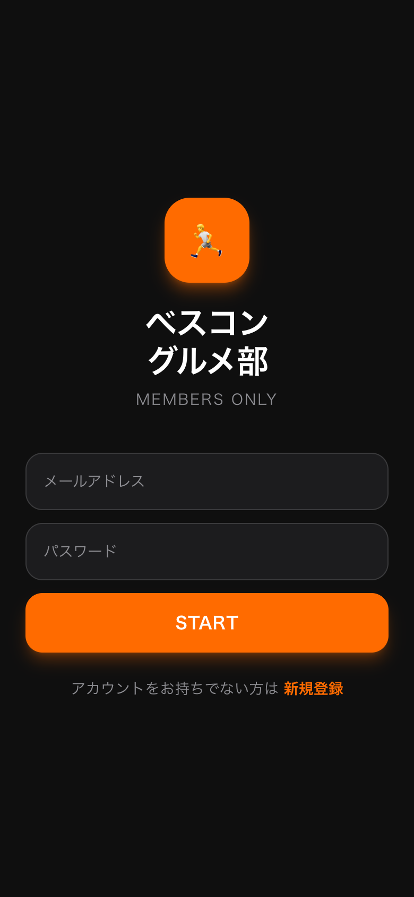

### 1.2 使える画面

次の4つの場所を使います。画面の下にあるバーで切り替えます。

| 場所 | 内容 |
|---|---|
| 「ホーム」 | チームの投稿が見られます |
| 「チーム」 | メンバー一覧、チームの切り替え・作成・参加ができます |
| 「投稿」（中央の📷ボタン） | 運動を記録して投稿します |
| 「マイページ」 | 自分のプロフィールとログアウトです |

グルメ、目標、イベントなどの画面は、現在は使えません。

### 1.3 使う道具

- スマートフォン（iPhone または Android）
- インターネットにつながる環境
- メールを受け取れるメールアドレス（登録のときに使います）
- スマートフォンの標準のブラウザ（iPhone は Safari、Android は Chrome）の新しいバージョンをおすすめします

パソコンのブラウザでも開けますが、画面はスマートフォン向けに作られています。

### 1.4 ホーム画面に追加する（おすすめ）

ホーム画面にアイコンを置くと、ブラウザを開かずにすぐ使えます。これは「ショートカット」を置く操作です。アプリのインストールではありません。

**iPhone（Safari）の場合**

1. アプリのページを Safari で開きます
2. 画面の下（または上）にある共有ボタンをタップします
3. 一覧から「ホーム画面に追加」を選びます
4. 右上の「追加」をタップします

**Android（Chrome）の場合**

1. アプリのページを Chrome で開きます
2. 右上のメニュー（点が縦に3つ並んだボタン）をタップします
3. 「ホーム画面に追加」を選びます
4. 画面の案内に従って追加します

ボタンの名前や位置は、機種や OS のバージョンで少し違うことがあります。

---

## 2. アカウント登録とログイン

### 2.1 新しく登録する

1. ログイン画面の下にある「新規登録」をタップします
2. 次の項目を入力します
   - 「名前」: ほかのメンバーに表示される名前です。ニックネームでかまいません
   - 「メールアドレス」: 確認コードが届くアドレスです
   - 「パスワード」: 大文字・小文字・数字をすべて含む8文字以上です
   - 「性別」: 「男性」「女性」「その他」から選びます
   - 「年代」: 「10代」「20代」「30代」「40代」「50代」「60代以上」から選びます
3. 「登録する」をタップします

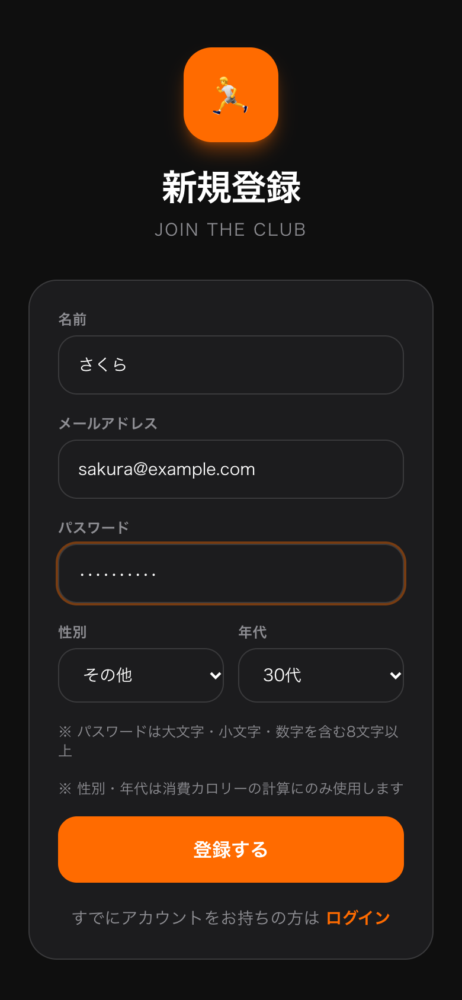

**気をつけること**

- 「名前」は、登録したあとにアプリの中では変えられません。よく考えて決めてください
- 「性別」と「年代」は、消費カロリーの計算にだけ使います。画面にも「※ 性別・年代は消費カロリーの計算にのみ使用します」と書かれています
- パスワードの条件を満たさないと、登録できません。エラーの文章は英語で出ることがあります

### 2.2 メールの確認コードを入力する

登録すると、メールアドレスあてに確認コードが届きます。

1. 画面に「メールを確認」と出ます
2. メールに書かれた数字（確認コード）を「確認コード」の欄に入力します
3. 「確認する」をタップします
4. ログイン画面に移ります

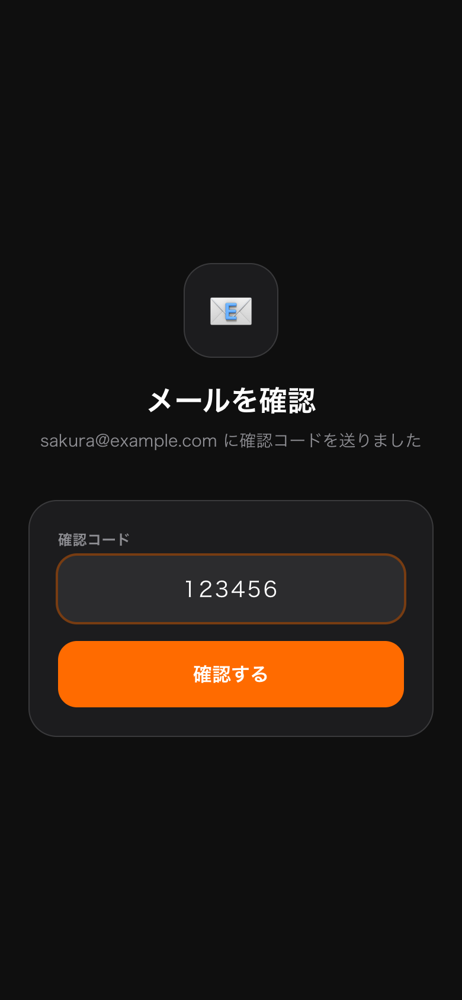

メールが届かないときは、迷惑メールのフォルダも見てください。それでも届かないときは、メールアドレスの入力まちがいかもしれません。

### 2.3 ログインする

1. 「メールアドレス」と「パスワード」を入力します
2. 「START」をタップします

ログインできると、ホーム画面（または、次の章のチームの選択画面）が開きます。

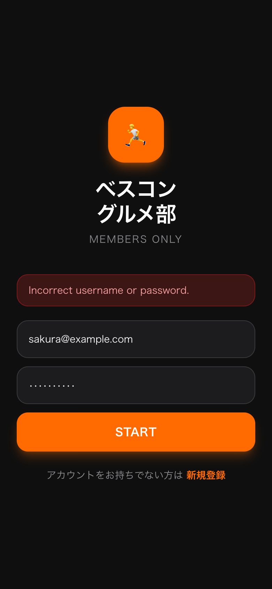

ログインに失敗すると、赤い枠で理由が出ます。この文章は、ログインを管理する仕組みが返すものです。英語で出ることがあります。メールアドレスとパスワードをもう一度確認してください。

この画面には、パスワードを再設定する機能がありません。パスワードを忘れたときは、アプリの運営担当者に相談してください。

### 2.4 ログアウトする

1. 画面の下の「マイページ」をタップします
2. 右上の「ログアウト」をタップします

ログアウトすると、ログイン画面にもどります。チームを選ぶ前の画面（3.1）でも、右上に「ログアウト」があります。

---

## 3. チームを使い始める

このアプリは、チームごとに投稿が分かれています。チームに入らないと、投稿は見られません。

### 3.1 最初の画面

登録してはじめてログインすると、「ようこそ！」の画面が出ます。次のどちらかを選びます。

- 「＋ チームを作成」: 自分で新しいチームを作ります
- 「🔑 チームに参加」: すでにあるチームに入ります

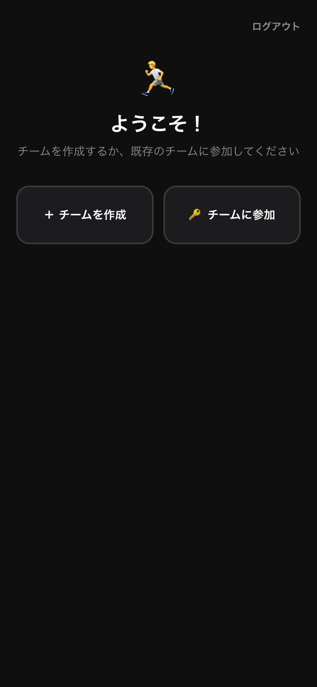

### 3.2 チームを作る

自分がオーナー（最初のメンバー）になります。

1. 「＋ チームを作成」をタップします
2. 「チーム名」を入力します（30文字までです）
3. 「合言葉」を入力します（6〜64文字です）
4. 「チームを作成」をタップします

合言葉の欄の右にある「表示」をタップすると、入力した文字が見えます。もう一度タップ（「隠す」）すると、見えなくなります。

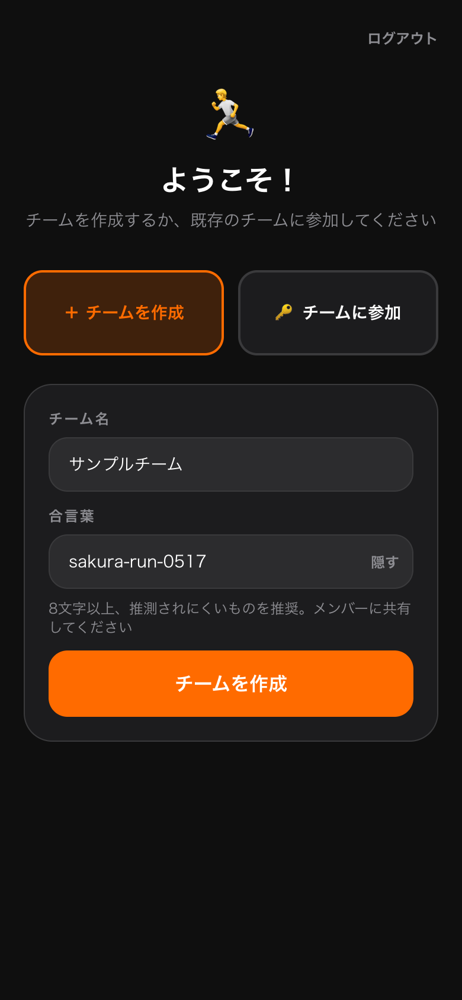

作ったチームは、すぐに表示されます。仲間には、チーム名と合言葉を伝えてください。

**入力まちがいのときのメッセージ**

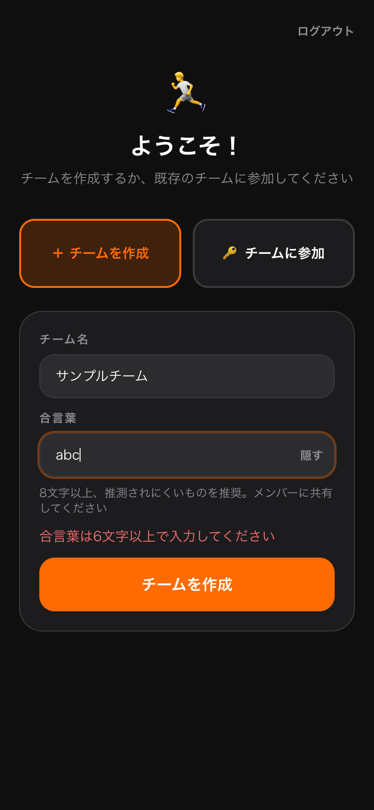

| メッセージ | 意味 |
|---|---|
| 「チーム名を入力してください」 | チーム名が空です |
| 「チーム名は30文字以内で入力してください」 | チーム名が長すぎます |
| 「合言葉は6文字以上で入力してください」 | 合言葉が短すぎます |
| 「合言葉は64文字以内で入力してください」 | 合言葉が長すぎます |
| 「チーム名に使えない文字が含まれています」 | 見えない文字などが入っています |
| 「合言葉に使えない文字が含まれています」 | 使えない文字が入っています |
| 「チームの作成回数が上限に達しました。N分後にもう一度お試しください」 | 1時間に作れるのは5回までです |
| 「参加できるチームは20個までです」 | 1人が入れるチームは20個までです |

**合言葉のルール**

- 6文字以上、64文字以下です
- 前後の空白は無視されます
- 全角の英数字は、半角にそろえて扱われます
- 英語の大文字と小文字は、区別されます

### 3.3 合言葉の決めかたと、伝えかた

画面には「8文字以上、推測されにくいものを推奨。メンバーに共有してください」と出ます。システムが受け付けるのは6文字からですが、8文字以上にしてください。

**よい合言葉**

- 8文字以上で、短い単語を2〜3個つなげたものです
- 数字や記号をまぜたものです
- チームの仲間が、聞いて入力できるものです

**避けたい合言葉**

- チーム名そのもの
- 誕生日、電話番号
- 「12345678」のような、すぐ当てられるもの

**伝えかた**

- 直接会って、または1対1のメッセージで伝えてください
- SNSの公開の投稿、チームの投稿やコメントには書かないでください
- 合言葉は、あとから画面で確認することはできません。伝えたあとも、オーナーが覚えておくか、安全な場所にメモしてください

### 3.4 チームに参加する

1. 「🔑 チームに参加」をタップします
2. チームの一覧から、入りたいチームをタップします
3. 「合言葉」の欄に、チームのオーナーから教わった合言葉を入力します
4. 「参加する」をタップします

一覧には、チーム名、メンバーの人数、作成者の名前が出ます。名前をしぼるときは、上の「チーム名で検索」に文字を入れてください。

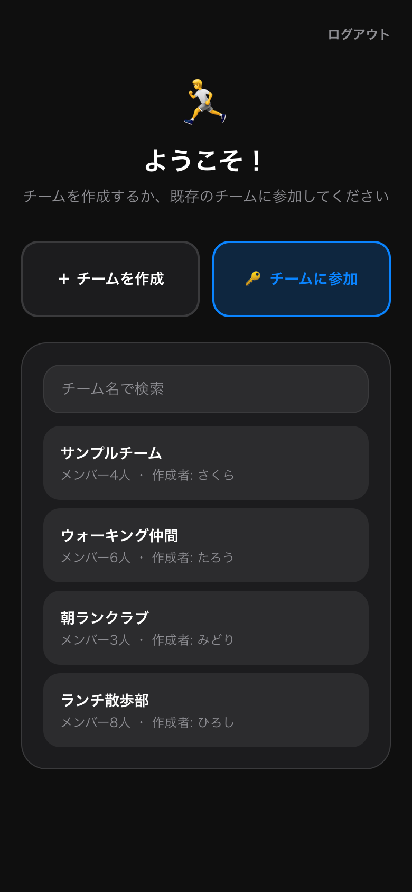

すでに入っているチームには、「参加中」と出ます。そのチームは選べません。

参加できると、そのチームのホーム画面が開きます。

**合言葉をまちがえたとき**

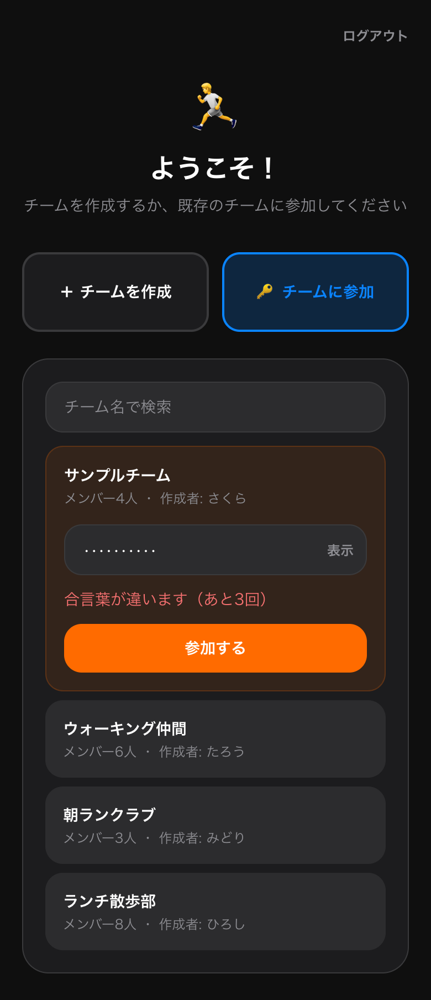

「合言葉が違います（あとN回）」と出ます。Nは、あと何回まで試せるかを表します。

- 同じチームに対して、15分のあいだに5回まで試せます
- 5回まちがえたあとは、続けて入力しようとしても受け付けられません
- この制限は、はじめて入力した時刻から15分で終わります。そのあと、回数はもとにもどります
- 別のチームの合言葉を試した分も合わせて、15分のあいだに20回までです
- 合言葉の入力そのものが短すぎる、長すぎるなどの入力エラーは、回数に数えません
- 参加できたときは、そのチームの回数はもとにもどります

**ロックされたとき**

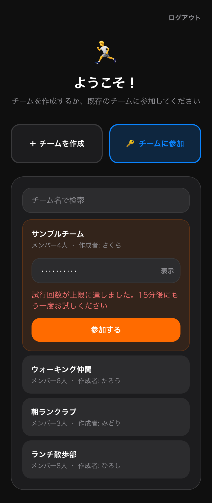

「試行回数が上限に達しました。N分後にもう一度お試しください」と出ます。Nは、制限が終わるまでの残り時間です。最大で15分です。時間がたつまで待ってください。待つあいだに、合言葉をオーナーに確認しましょう。

**そのほかのメッセージ**

| メッセージ | 意味 |
|---|---|
| 「チーム一覧を読み込めませんでした」 | 一覧が取得できません。通信を確認して、もう一度開いてください |
| 「該当するチームがありません」 | 検索した名前のチームがありません |
| 「チームが多いため一部のみ表示しています。名前で検索して絞り込んでください」 | 一覧に出るのは一部です。名前で探してください |
| 「このチームは満員です」 | 1チームの人数は100人までです |
| 「チームが見つかりません」 | チームがなくなっています |

### 3.5 チームを切り替える

複数のチームに入っているとき、見ているチームを切り替えられます。1人が入れるのは20チームまでです。

1. ホーム画面の左上にある、チームの名前をタップします
2. 「チームを切り替え」の画面が開きます
3. 見たいチームをタップします

今見ているチームには、「✓」がつきます。

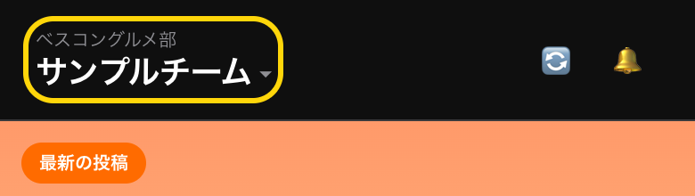

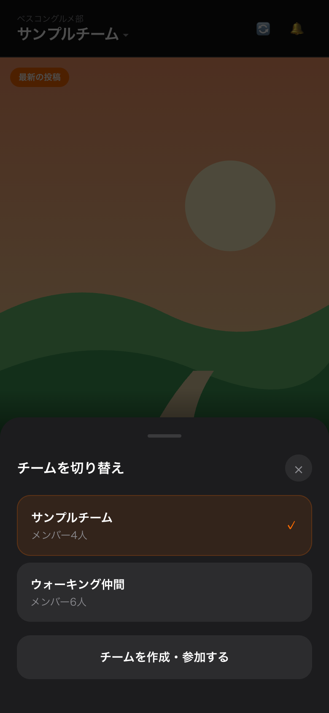

この画面の下の「チームを作成・参加する」をタップすると、「チーム」タブに移ります。「チーム」タブの「マイチーム」からも切り替えられます。

**最後に選んだチームについて**

最後に選んだチームは覚えられています。次にアプリを開いたとき、そのチームが表示されます。別の端末で開いたときも、同じチームが開くことがあります。

投稿するときは、画面に出る「投稿先: チーム名」のチームに送られます。切り替えたあとは、投稿先を確認してください。

### 3.6 チームを抜ける

1. 画面の下の「チーム」をタップします
2. いちばん上のカードにある「チームを抜ける」をタップします
3. 「『チーム名』を抜けますか？投稿はチームに残り、再参加には合言葉が必要です。」と出ます
4. 抜けるときは「抜ける」、やめるときは「キャンセル」をタップします

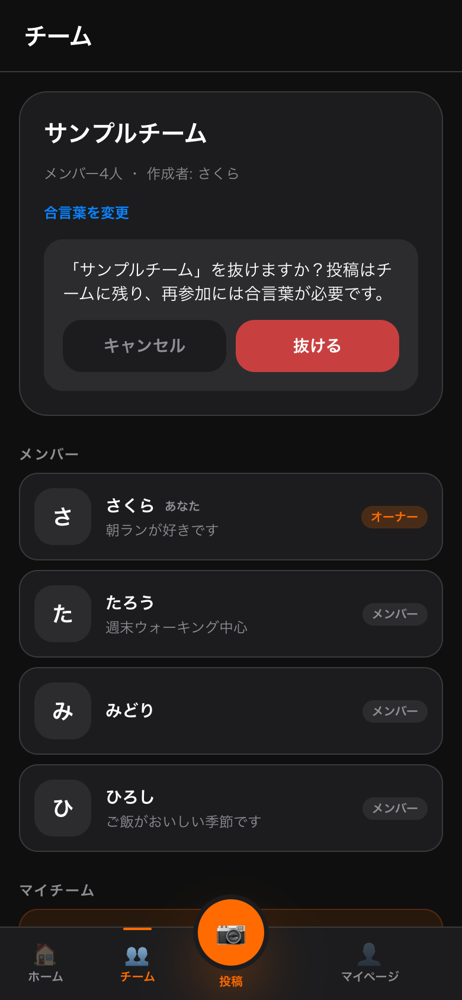

- 自分の投稿は、チームに残ります
- もう一度入るには、合言葉が必要です
- 抜けたあと、ほかに入っているチームがあれば、そのチームが開きます。ない場合は、最初の画面（3.1）にもどります
- チームの最後の1人は、抜けられません。そのときは「最後の1人はチームを抜けられません」と出ます

---

## 4. ホーム画面の見かた

「ホーム」には、今見ているチームの投稿が出ます。新しい順に並びます。

### 4.1 画面の構成

上から順に説明します。

1. 画面のいちばん上: 左にチームの名前、右に「🔄」（更新）と「🔔」（通知）
2. 最新の投稿: いちばん新しい投稿が、大きく出ます
3. 「タイムライン」: 最新の投稿を除いた、ほかの投稿が新しい順に並びます
4. 画面の下: 「ホーム」「チーム」「投稿」「マイページ」

同じ投稿が、最新の投稿とタイムラインの両方に出ることはありません。

### 4.2 最新の投稿（写真があるとき）

写真が大きく出ます。左上に「最新の投稿」の印がつきます。写真の下に、投稿した人の名前、時間、運動の種類が出ます。その下に、コメントと、距離（km）・時間（分）・消費カロリー（kcal）が出ます。

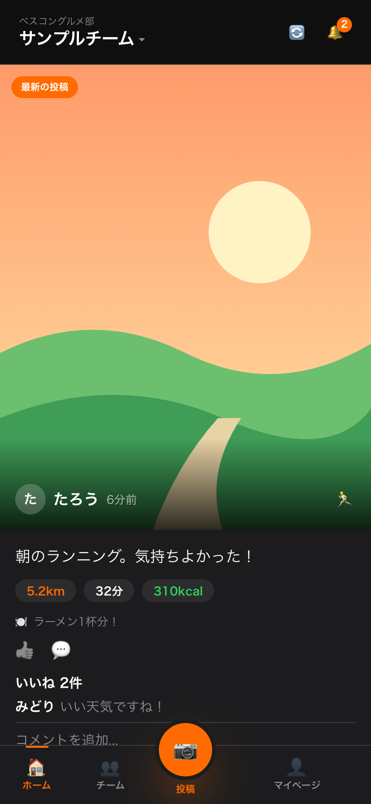

### 4.3 最新の投稿（写真がないとき）

写真がない投稿でも、いちばん新しければ、いちばん上に出ます。「最新の投稿」の印がつき、距離（KM）、時間（MIN）、消費カロリー（KCAL）が大きな数字で出ます。

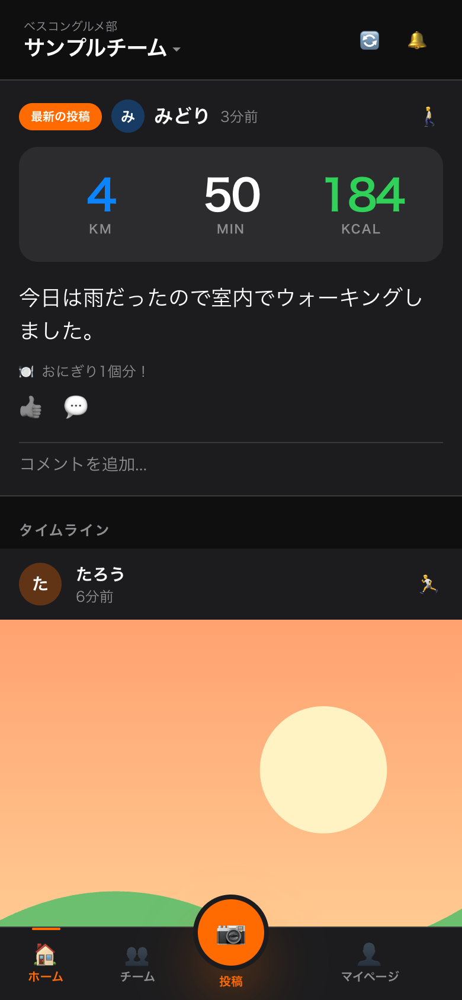

### 4.4 タイムライン

最新の投稿より前の投稿が、「タイムライン」に並びます。

- 写真がある投稿は、写真を大きく出します。距離・時間・消費カロリーは、写真の下の右側に出ます
- 写真がない投稿は、数字を大きく出します

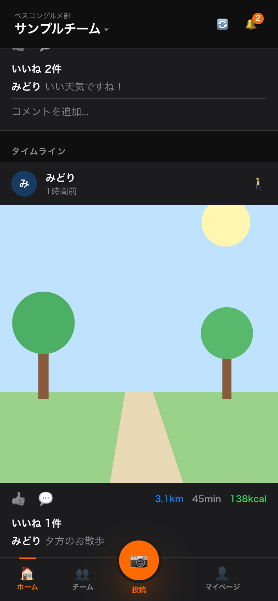

次のメッセージが出ることもあります。

| メッセージ | 意味 |
|---|---|
| 「最初の記録をしよう！」「中央のボタンから運動を記録できます」 | このチームには、まだ投稿がありません |
| 「他の投稿はまだありません」 | 投稿が1件だけです |
| 「投稿を読み込めませんでした」と「再読み込み」ボタン | 投稿を取得できませんでした。「再読み込み」をタップしてください |
| 「更新に失敗しました」 | 更新に失敗しました。もう一度「🔄」をタップしてください |

画面に出るのは、新しい順で最大50件です。

投稿の時間は、「たった今」「N分前」「N時間前」「N日前」の形で出ます。

### 4.5 「🔄」更新ボタン

ほかの人の新しい投稿は、自動では出ません。新しい投稿を見るときは、「🔄」をタップしてください。そのとき、通知の数も更新されます。

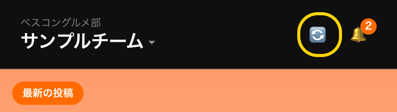

自分で投稿したあとは、ホーム画面が自動で更新されます。

### 4.6 「🔔」通知

だれかが、あなたの投稿にいいねやコメントをすると、通知が来ます。

- 「🔔」に、未読の数が出ます。10件以上は「9+」と出ます
- 「🔔」をタップすると、「通知」の画面が開きます。開くと、すべて読んだことになります
- 通知の文章は、「〇〇さんがいいねしました」や「〇〇さんがコメントしました：…」の形です
- 通知がないときは、「通知はありません」と出ます
- 閉じるときは、右上の「×」をタップします

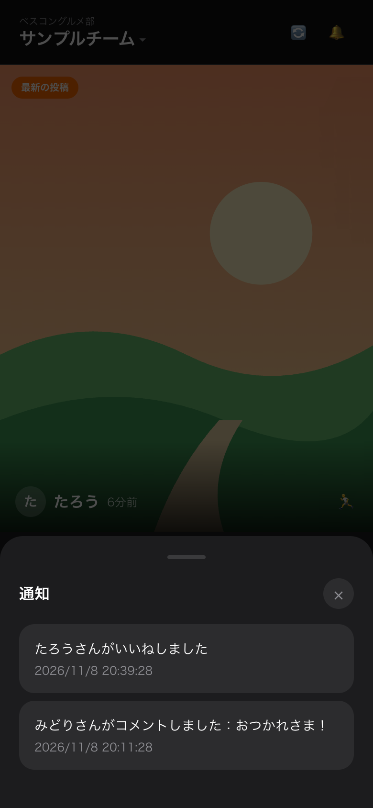

自分の投稿への、自分のいいねやコメントは、通知されません。

---

## 5. 運動を記録して投稿する

### 5.1 投稿のしかた（3つのステップ）

1. 画面の下の中央にある、オレンジ色の「📷」ボタン（「投稿」）をタップします

   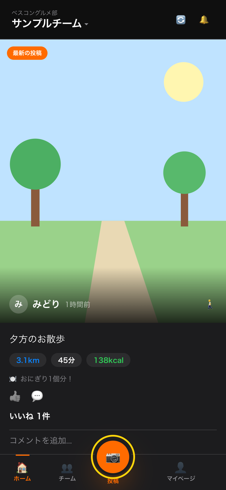

2. 「ワークアウトを記録」の画面が開きます。画面の上に「投稿先: チーム名」が出ます。投稿先のチームを確認してください。右上の3つの点は、今が何番目のステップかを表します

**ステップ1: 運動の種類**

1. 「🏃 ランニング」か「🚶 ウォーキング」をタップします
2. 「次へ →」をタップします

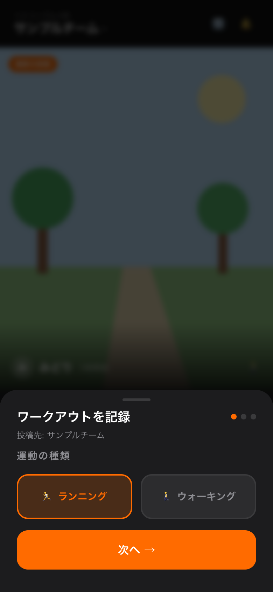

**ステップ2: 距離・時間を入力**

1. 「距離 (km)」に、走った（歩いた）距離を入力します。小数点も使えます（例: 5.0）
2. 「時間 (分)」に、かかった時間を分で入力します（例: 30）
3. 「次へ →」をタップします
4. 前の画面にもどるときは、「← 戻る」をタップします

距離と時間の、どちらかが空のあいだは、「次へ →」をタップできません。

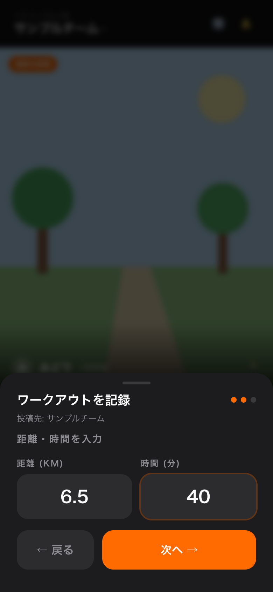

**ステップ3: 写真・コメント・確認**

1. 写真をつけるときは、「タップして写真を選択」をタップします。写真は1枚だけです（5.3を見てください）
2. 消費カロリーの目安が、緑の枠に出ます（5.2を見てください）
3. 「コメント（任意）」に、ひとことを書きます（500文字までです）
4. 「記録する！」をタップします

写真とコメントは、なくても投稿できます。

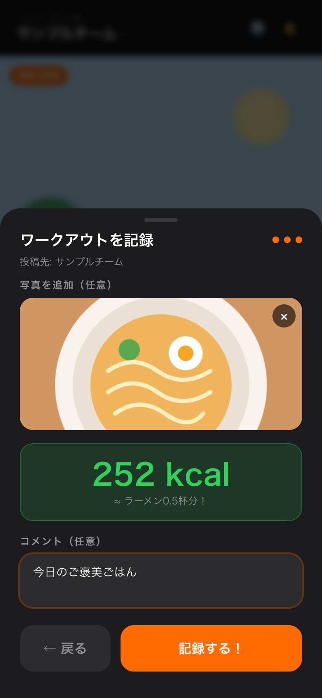

投稿が終わると、「記録完了！」と「お疲れ様でした！」が2秒ほど出ます。そのあと、ホーム画面が更新され、自分の投稿がいちばん上に出ます。

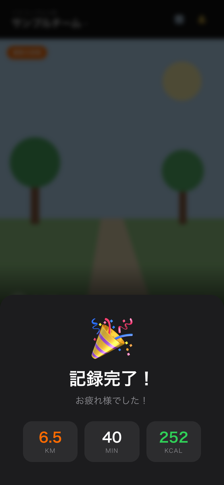

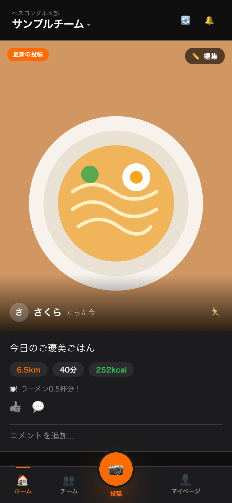

**気をつけること**

- 入力の途中で、まわりの暗い部分をタップすると、画面が閉じます。入力した内容は消えます
- 距離は0〜1000km、時間は0〜1440分の範囲で入力してください。範囲の外だと、投稿できません

### 5.2 消費カロリーについて

消費カロリーは、あくまで目安です。

- 運動の種類（ランニングとウォーキング）と、時間から計算します
- 計算には、性別と年代ごとに決められた体重の目安を使います。実際の体重は使いません
- 距離は、計算に使いません
- 入力中に出る目安は、登録のときの性別・年代で計算します
- 投稿のあとに保存される値は、「マイページ」に保存されている性別・年代で、サーバーが計算します。「マイページ」で変えていなければ、同じ数字です

「≈ ラーメン0.5杯分！」のような表示は、カロリーを食べ物にたとえたものです。

### 5.3 写真について

- 写真は、端末の案内に従って、撮影するか、保存した写真から選びます。表示は機種によって違います
- 大きな写真は、自動で小さくされます。長いほうの辺が1600ピクセルまでに、JPEG形式に変換されます。スマートフォンの写真を、そのまま選んで大丈夫です
- 写真の向きは、そろえられます
- 選んだ写真をやめるときは、写真の右上にある「×」をタップします
- ブラウザが読めない形式の写真は、アップロードに失敗することがあります

**写真のアップロードに失敗したとき**

「写真のアップロードに失敗しました。もう一度お試しください」と出ます。この場合、投稿はまだ作られていません。入力した内容は、そのまま残っています。

1. 電波の状態を確認します
2. もう一度「記録する！」をタップします
3. それでも失敗するときは、別の写真を選ぶか、写真を外して投稿します

投稿そのものに失敗したときは、「投稿に失敗しました。もう一度お試しください」と出ます。同じように、もう一度試してください。

投稿のボタンには、途中の状態として「アップロード中...」「投稿中...」と出ます。終わるまで待ってください。

---

## 6. 投稿へのリアクション（いいね・コメント）

### 6.1 いいね

1. 投稿の下にある「👍」をタップします
2. いいねをすると、「👍」に色がつきます。いいねの数は、「いいね N件」と出ます
3. 取り消すときは、もう一度「👍」をタップします

### 6.2 コメント

1. 投稿の下の「コメントを追加...」の欄に、文字を入力します
2. 右に出る「投稿」をタップします

コメントは、投稿の下に、名前といっしょに出ます。

- 2件までが出ます。3件以上あるときは、「コメントをすべて見る（N件）」をタップすると、すべて出ます
- 「💬」のマークは、目印です。タップしても何も起きません。コメントは、下の入力欄から書いてください
- 書いたコメントを、あとから直したり、消したりする機能はありません

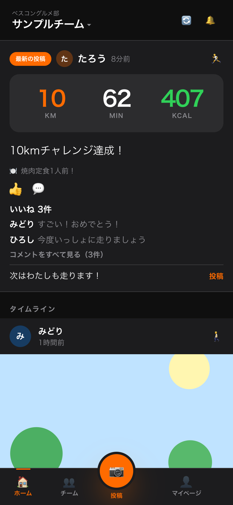

---

## 7. 自分の投稿を編集する

自分の投稿だけ、あとから直せます。ほかの人の投稿には、編集のボタンは出ません。

### 7.1 編集のしかた

1. 自分の投稿の「✏️ 編集」をタップします（最新の投稿では写真の右上、タイムラインでは名前の行の右側にあります）

   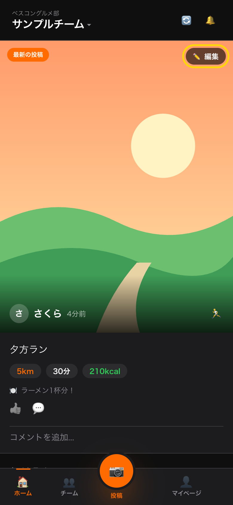

2. 「投稿を編集」の画面が開きます
3. 直したいところを変えます
4. 「保存する」をタップします。やめるときは「キャンセル」をタップします

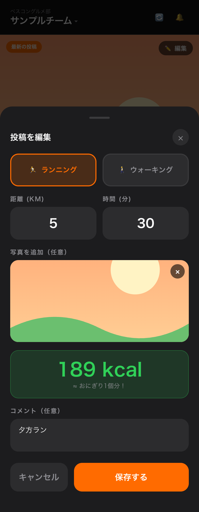

### 7.2 変えられるもの

- 運動の種類（「🏃 ランニング」「🚶 ウォーキング」）
- 距離と時間
- 写真
- コメント

変えられないもの: 投稿したチーム、投稿した日時です。投稿を削除する機能は、現在ありません。

距離と時間が空のあいだは、「保存する」をタップできません。

保存すると、消費カロリーが計算し直されます。いいねとコメントは、そのまま残ります。

### 7.3 写真をそのまま使う・差し替える・外す

| やりたいこと | 操作 |
|---|---|
| そのまま使う | 写真には何もしません |
| ほかの写真に差し替える | 写真の右上の「×」をタップして外します。出てくる「タップして写真を選択」から、新しい写真を選びます |
| 写真を外す | 写真の右上の「×」をタップして、「保存する」をタップします |

### 7.4 「編集済み」

編集した投稿には、時間のとなりに「編集済み」と出ます（例:「4分前・編集済み」）。

### 7.5 編集のときのメッセージ

| メッセージ | 意味 |
|---|---|
| 「自分の投稿だけ編集できます」 | ほかの人の投稿は編集できません |
| 「写真のアップロードに失敗しました。もう一度お試しください」 | 写真を送れませんでした |
| 「保存に失敗しました。もう一度お試しください」 | 保存できませんでした。もう一度「保存する」をタップしてください |

---

## 8. 「チーム」タブ

画面の下の「チーム」をタップすると、チームの情報が出ます。

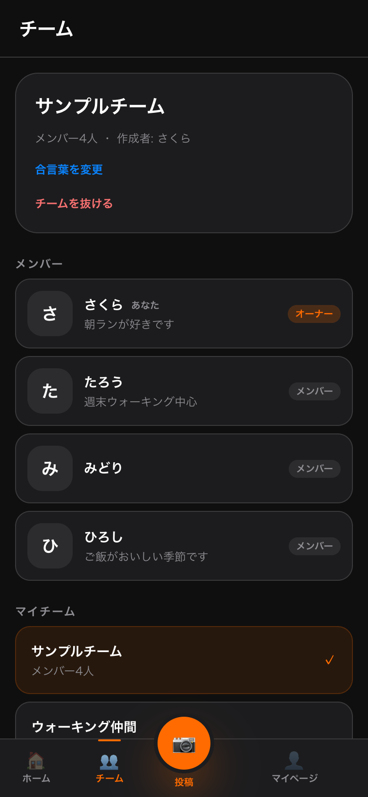

### 8.1 今のチームとメンバー

- いちばん上のカード: チーム名、メンバーの人数、作成者の名前が出ます。「チームを抜ける」もここです。オーナーには、「合言葉を変更」も出ます
- 「メンバー」: チームの仲間の一覧です。名前、自己紹介、アイコンが出ます
- 自分のところには、「あなた」と出ます
- 名前の右の印は、役割です。「オーナー」（チームを作った人など）と「メンバー」があります

メンバーを一覧から外したり、チームを削除したりする機能は、現在ありません。

メンバーの一覧が読み込めないときは、「メンバーを読み込めませんでした」と出ます。「再読み込み」をタップしてください。

### 8.2 マイチーム（切り替え、作成、参加）

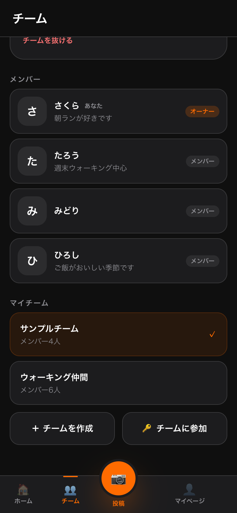

- 「マイチーム」: 自分が入っているチームの一覧です。タップすると、そのチームに切り替わります
- 「＋ チームを作成」: 新しいチームを作ります（3.2と同じです）

  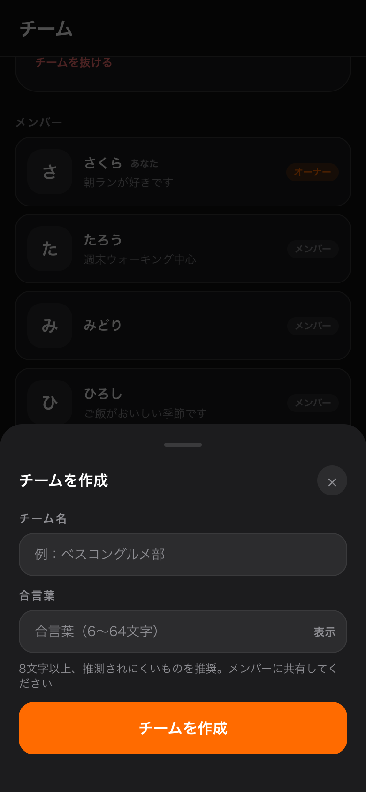

- 「🔑 チームに参加」: 合言葉でチームに入ります（3.4と同じです）

  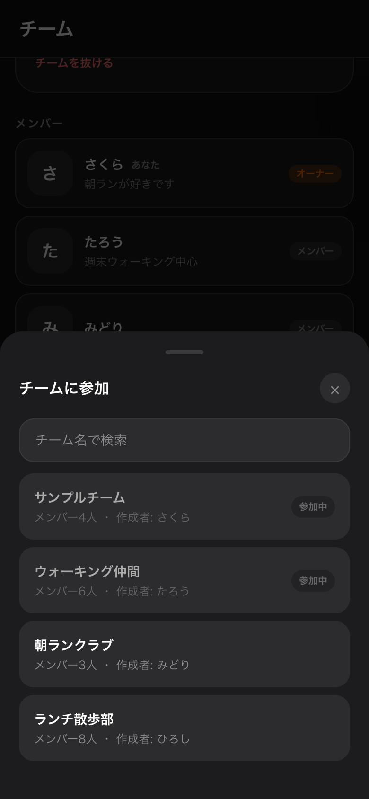

### 8.3 チームを抜ける

3.6を見てください。

---

## 9. 「マイページ」

画面の下の「マイページ」をタップします。

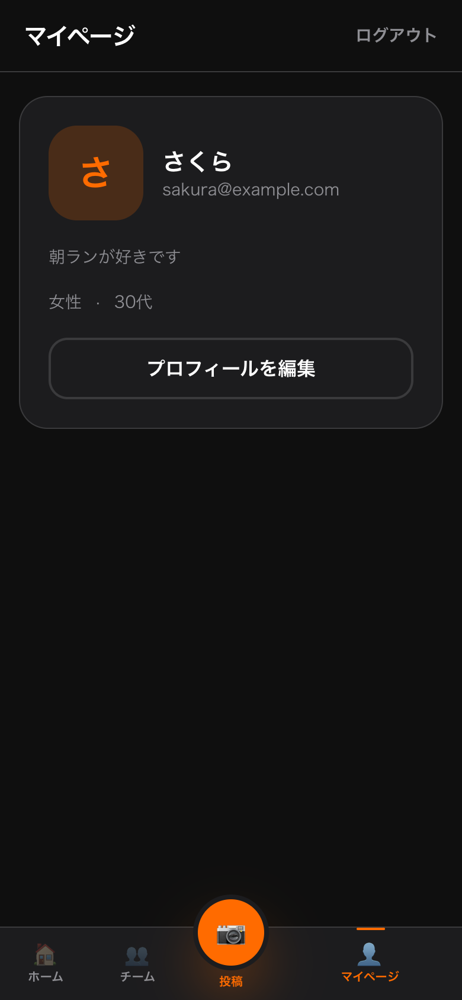

### 9.1 見られるもの

- アイコン、名前、メールアドレス
- 自己紹介（まだないときは「自己紹介がまだ設定されていません」と出ます）
- 性別と年代

名前とメールアドレスは、ここでは変えられません。

### 9.2 プロフィールを直す

1. 「プロフィールを編集」をタップします
2. 「自己紹介」「性別」「年代」を直します
3. 「保存する」をタップします。やめるときは「キャンセル」をタップします

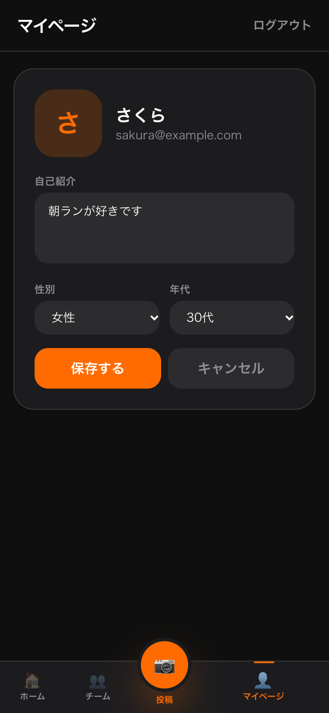

自己紹介は200文字まで入力できます。

性別と年代を変えると、これからの投稿の消費カロリーの計算に使われます。

### 9.3 アイコンの写真を変える

1. 「マイページ」の、アイコン（写真がないときは名前の頭文字）をタップします
2. 写真を選びます
3. 「アップロード中...」の表示が消えると、変更が終わります

写真を選んでも変わらないときは、通信を確認して、もう一度試してください。アイコンを選ぶと、エラーが出ずに何も変わらないことがあります。

アイコンは、チームのメンバーの画面に出ます（投稿やメンバー一覧）。

### 9.4 ログアウト

画面の右上の「ログアウト」をタップします。

---

## 10. 困ったときは（よくある質問）

**Q. 写真が出ません。「写真を読み込めませんでした」と出ます**

A. 最新の投稿に、「📷 写真を読み込めませんでした」と出ることがあります。次のことを試してください。

1. 「🔄」をタップします。写真をもう一度読み込みます
2. 直らないときは、ブラウザで、ページを再読み込みします
3. 電波の状態を確認します

タイムラインの投稿は、写真が読み込めないとき、数字（KM・MIN・KCAL）の表示にかわります。

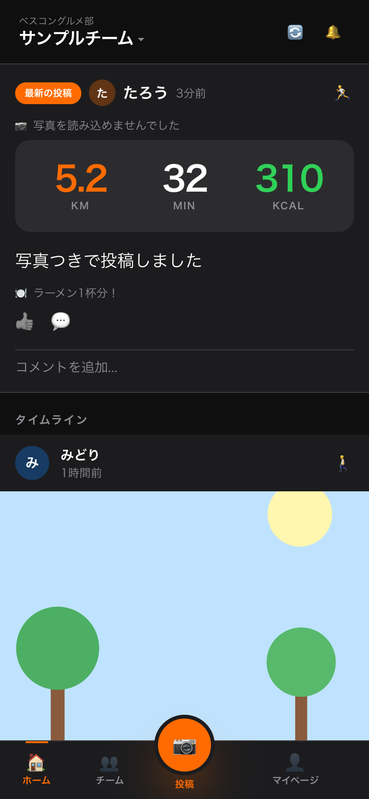

**Q. 投稿したのに、いちばん上に出ません**

A. 「🔄」をタップしてください。それでも出ないときは、ブラウザでページを再読み込みしてください。また、投稿するときの「投稿先」と、今見ているチームが同じか確認してください。

**Q. 仲間の投稿が出ません**

A. 新しい投稿は、自動では出ません。「🔄」をタップしてください。

**Q. 合言葉を忘れました**

A. 合言葉は、画面で確認できません。チームのオーナーに聞いてください。オーナーは、合言葉を新しく変えられます（12章）。

**Q. 「試行回数が上限に達しました」と出ます**

A. 合言葉をまちがえすぎています。メッセージに出る時間（最大15分）をまってから、もう一度入力してください。待つあいだに、オーナーに合言葉を確認しましょう。

**Q. 画面が古いままです・おかしいです**

A. ブラウザでページを再読み込みしてください。ホーム画面に追加している場合は、いったんアプリを閉じてから開き直してください。

**Q. ほかの人の投稿を編集したいです**

A. できません。「✏️ 編集」は、投稿した本人だけに出ます。

**Q. まちがえたチームに入ってしまいました**

A. 「チーム」タブで、「チームを抜ける」をタップします（3.6）。自分が最後の1人のときは抜けられません。その場合は、ほかのチームに切り替えて使ってください。

**Q. まちがえたチームに投稿してしまいました**

A. 投稿先を、あとから変える機能はありません。投稿を削除する機能もありません。次から、「投稿先: チーム名」を確認してから投稿してください。

**Q. 投稿を消したいです**

A. 削除の機能は、現在ありません。内容は「✏️ 編集」で直せます。

**Q. 「チーム情報を読み込めませんでした」と出ます**

A. 通信ができていません。「再読み込み」をタップしてください。直らないときは「ログアウト」して、入り直してください。

**Q. 「このチームのメンバーではありません」と出ます**

A. ほかの端末で、そのチームを抜けた可能性があります。「チーム」タブで、入っているチームを確認してください。

**Q. 「処理が競合しました。もう一度お試しください」と出ます**

A. 同じ時間に、別の操作が重なりました。少し待ってから、もう一度操作してください。

**Q. コメントを書いても、出ません**

A. 通信が不安定なとき、エラーが出ずに、コメントが送られないことがあります。電波を確認して、もう一度「投稿」をタップしてください。

**Q. パスワードを忘れました**

A. この画面には、再設定の機能がありません。アプリの運営担当者に相談してください。

**Q. アカウントを消したいです**

A. 画面からは、アカウントを消せません。アプリの運営担当者に相談してください。

---

## 11. プライバシーと注意事項

安心して使うために、次のことを知っておいてください。

**写真とアイコンについて**

- 投稿した写真と、プロフィールのアイコンは、インターネット上の「アドレス（URL）」の場所に保存されます
- そのアドレスを正確に知っている人は、チームのメンバーでなくても、写真を開けます
- アドレスは長く複雑で、推測はむずかしい作りです。ただし、秘密の場所に置かれているわけではありません
- アドレスを、アプリの外に貼りつけて広めないでください
- 人に見られて困る写真（住所がわかる景色、家族や子どもの顔、書類、クレジットカードなど）は、投稿しないでください
- 写真に写った人の許可をとってから投稿してください

**チームについて**

- チームの名前、人数、作成者の名前は、ログインしている人なら、だれでも一覧で見られます
- チームの投稿、コメント、メンバー一覧は、アプリの画面では、そのチームのメンバーだけが見られます
- 自分の名前、自己紹介、アイコンは、同じチームのメンバーに見えます
- メールアドレス、性別、年代は、ほかのメンバーの画面には出ません
- 合言葉を知っている人は、だれでもチームに入れます。公開の場所に書かないでください

**そのほか**

- 抜けたチームにも、自分の投稿は残ります
- 投稿した内容には、ほかの人を傷つける言葉や、ほかの人の個人情報を書かないでください
- 消費カロリーは目安です。健康のための判断には使わないでください

---

## 12. オーナー（チームを作った人）向けの案内

チームを作った人は、「オーナー」になります。「チーム」タブの、いちばん上のカードに、「合言葉を変更」が出ます。

### 12.1 合言葉をメンバーに伝える

チームを作ったら、チーム名と合言葉を、仲間に伝えます。伝えかたは、3.3を見てください。

- 合言葉は、画面であとから確認できません。忘れないようにしてください
- 仲間が合言葉を忘れたときは、オーナーに問い合わせが来ます。教えるか、新しく変えてください
- 合言葉を知らない人は、チームに入れません

### 12.2 合言葉を変える

1. 画面の下の「チーム」をタップします
2. いちばん上のカードにある「合言葉を変更」をタップします
3. 「新しい合言葉（6〜64文字）」の欄に、新しい合言葉を入力します
4. 「変更する」をタップします。やめるときは「キャンセル」をタップします

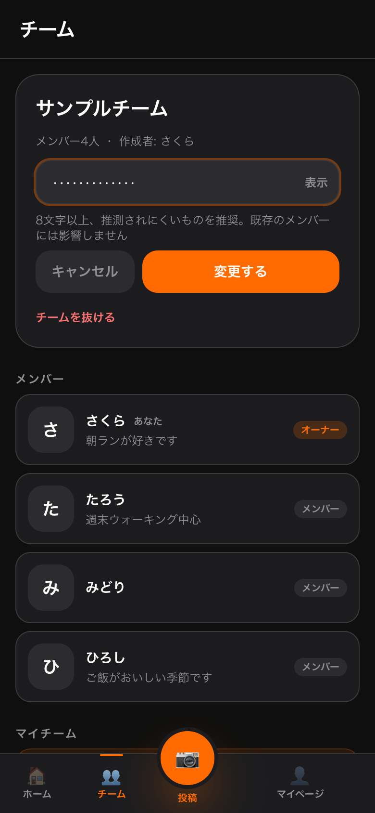

変えると、「合言葉を変更しました」と出ます。

- 今入っているメンバーには、影響しません。これからの参加に、新しい合言葉が必要になります
- 変えられるのは、1時間に10回までです。超えると「合言葉の変更回数が上限に達しました。N分後にもう一度お試しください」と出ます
- 合言葉を変えたあとは、まだ入っていない仲間に、新しい合言葉を伝えてください

### 12.3 オーナーがチームを抜けるとき

オーナーも、「チームを抜ける」で抜けられます（3.6）。

- ほかのメンバーがいないとき（最後の1人のとき）は、抜けられません
- オーナーが抜けて、ほかにオーナーがいない場合は、残っているメンバーのうち、いちばん早く入った人が、自動で新しいオーナーになります

---

## 13. 用語集

| 用語 | 意味 |
|---|---|
| チーム | 投稿を共有する仲間のグループです |
| 合言葉 | チームに入るときに必要な、チームごとの秘密の言葉です |
| オーナー | チームを作った人です。合言葉を変えられます |
| メンバー | チームに入っている人です |
| 投稿 | 運動の記録を、チームに送ることです |
| 最新の投稿 | ホーム画面のいちばん上に出る、チームでいちばん新しい投稿です |
| タイムライン | 最新の投稿のあとに、新しい順に並ぶ投稿の一覧です |
| 編集済み | あとから内容を直した投稿につく印です |
| KM / MIN / KCAL | 距離（キロメートル）、時間（分）、消費カロリーです |
| 確認コード | 登録のとき、メールで届く数字です |
| ホーム画面に追加 | スマートフォンのホーム画面に、ショートカットを置くことです |

---

## 14. 更新履歴

| 日付 | 内容 |
|---|---|
| 2026-11-08 | 初版 |
